

  

---

  <strong>Scegli la lingua / Choose your language:</strong>

  
🇮🇹 <strong>ITALIANO (Clicca per espandere)</strong>

<h1 align="center">
  VMC MASTER
  
  
</h1>

  <strong>La tua ventilazione meccanica controllata in Home Assistant.</strong> 
  Package avanzato per VMC Helty Flow Plus / Elite: logiche con priorità, controllo locale e remoto, avvisi affidabili.

  <a href="mailto:danilo.robotti@gmail.com">danilo.robotti@gmail.com</a>

  Hai già provato <strong><a href="https://github.com/DanRobo76/Aspiratore">ASPIRATORE MASTER</a></strong> e <strong><a href="https://github.com/DanRobo76/VMC-HELTY-FLOW-LIGHT/tree/main">VMC Versione Light</a></strong>?

---

<strong>Perché VMC MASTER</strong>

**VMC MASTER** è un package avanzato per Home Assistant progettato per la gestione delle VMC **Helty Flow Plus / Elite** (gestite con l'app Air Guard), sia in locale sia da remoto.
 
Non è un semplice telecomando, ma una logica evoluta che confronta in continuo le condizioni interne ed esterne (temperatura, umidità, punto di rugiada, inquinanti) e decide se e a quale velocità far funzionare la VMC, con priorità precise tra le allerte e la ripresa automatica della velocità impostata.

<strong>Cosa lo rende diverso</strong>

| Funzione | Vantaggio |
|---|---|
| **Logiche con priorità** | Congelamento, Δ temperatura, inquinanti, punto di rugiada, Free Cooling / Free Heating, umidità e black-out gestiti in un ordine preciso, con ripresa automatica |
| **Controllo del punto di rugiada** | La VMC si arresta quando porterebbe in casa umidità dall'esterno |
| **Free Cooling / Free Heating** | Nessun raffrescamento o riscaldamento indesiderato nei mesi programmati; aria calda o fresca gratuita quando conviene |
| **Qualità dell'aria** | Avvio e arresto in funzione di CO₂ e VOC (sensori della VMC Flow Elite; CO₂ anche da un'entità di Home Assistant) |
| **Controllo dell'umidità interna** | Avvio automatico alla velocità programmata, anche con aria secca (≤ 35%), e ritorno alla velocità memorizzata |
| **Calendario** | 2 fasce orarie per ogni giorno della settimana e 2 fasce mensili |
| **Selezione dinamica delle entità** | Sensori di Home Assistant e servizi meteo al posto dei sensori della VMC, con offset |
| **Intestazione animata** | Il flusso d'aria scorre in funzione della portata e il colore del LED indica lo stato: bianco normale, giallo allerta, blu umidità, rosso inquinanti, grigio OFF-Line; la scritta «Alert» sotto i tasti avvisa prima di avviare la VMC |
| **Avvisi e notifiche** | Su dispositivo mobile e tramite Media Player |
| **Più VMC** | Clonazione e cancellazione dalla Finestra Clona del pannello Impostazioni, senza riavvii intermedi |

<strong>Vantaggi principali</strong>

- Configurazione dall'interfaccia, senza modificare lo YAML
- Controllo locale e remoto della VMC
- Ripresa automatica della velocità al termine di ogni allerta
- Ripristino della velocità dopo un black-out (VMC con linea dedicata nel quadro elettrico e/o relè domotico)
- Calcolo di ricambi d'aria, portata, umidità assoluta e comfort igrometrico
- Cambio dell'indirizzo IP e del nome della VMC dall'interfaccia
- Conferma prima di ogni script («Vuoi Procedere?»); conferma «Sì / No» per la pulizia della cronologia e per la cancellazione di una VMC
- Pannello Informazioni con 24 voci illustrate che spiegano ogni funzione
- Avviso quando è disponibile un nuovo aggiornamento

<strong>Funzionalità complete</strong>

- Permette di selezionare quali Avvisi ascoltare tramite il Media Player selezionato.
- Permette di selezionare le entità Media Player, per ascoltare lo stato degli Avvisi e la Velocità.
- Indicatore Andamento Rischio Muffa.
- Indicatore che converte il punto di rugiada (TPdR) in una classificazione qualitativa del comfort igrometrico all'interno dell'ambiente.
- Visualizza in tempo reale: il numero totale di ricambi d'aria effettuati nella giornata, il volume totale di aria scambiata (m³) e il tempo rimanente prima del prossimo ricambio completo [Cliccare su Telecomando].
- Elenca tutte le VMC installate in una tabella, una colonna per VMC [Pannello Informazioni → voce 22].
- Intestazione animata: flusso d'aria proporzionale alla portata e colore del LED in funzione dello stato; scritte «Alert», «Alert Δ Temp.» e «Alert Free» sotto i tasti di velocità quando un'allerta bloccherebbe o ridurrebbe la VMC [Pannello Informazioni → voce 23].
- Permette di selezionare le entità di: Temperatura (Interna ed Esterna), Umidità (Interna ed Esterna), Anidride Carbonica CO₂ (Interna) e Dispositivo Mobile, disponibili in Home Assistant, includendo anche le entità provenienti da fonti Meteo, per ottenere maggiore precisione e affidabilità rispetto ai sensori integrati della VMC.
- Avvisa l'utente tramite notifica sul Dispositivo Mobile in caso di Avvio, Arresto, Errori o cambio filtro della VMC.
- Permette l'accensione e lo spegnimento automatico in funzione degli inquinanti (CO₂ e/o VOC) [sensori della VMC presenti solo nella VMC HELTY FLOW ELITE; per la CO₂ si può selezionare anche un'entità di Home Assistant].
- Permette l'accensione e lo spegnimento automatico in funzione dell'Umidità Interna Settata (sopra il valore impostato, oppure con aria secca ≤ 35% per far entrare aria dall'esterno).
- Se si dispone di più VMC, permette di clonarle e cancellarle dalla Finestra Clona del pannello Impostazioni, presente solo nella VMC Master: controllo del nome e dell'IP, più clonazioni senza riavvio, cancellazione con conferma «Sì / No» (vedi Installazione, punto 11).
- Al primo avvio dopo l'aggiornamento dalla release 8.4.1 o precedenti cancella da solo i file della vecchia Clona VMC (vmc_clona.yaml e vmc_clona_scheda_manuale_interfaccia.txt).
- Permette lo spegnimento automatico in funzione della Temperatura Esterna ≤ -18 °C e successiva ripresa in funzione degli offset impostati.
  > **Nota:** per impostazione firmware, la priorità è assegnata al sensore interno della VMC rispetto al valore rilevato dal sensore esterno dell'entità selezionata.
- Permette l'avvio automatico a Velocità 1 in funzione della Differenza Temperatura Interna - Temperatura Esterna se > 23 °C e successiva ripresa.
  > **Nota:** per impostazione firmware, la priorità è assegnata ai sensori interni della VMC rispetto ai valori rilevati dal sensore esterno dell'entità selezionata.
- Permette di cambiare l'IP della VMC dall'interfaccia utente («Cambia IP VMC (Riavvio di H.A.)»).
- Permette di rinominare la VMC dall'interfaccia utente («Cambia Nome VMC»).
- Permette il controllo remoto e locale della VMC.
- Permette l'accensione e lo spegnimento in funzione di 2 fasce orarie programmabili per ogni giorno della settimana.
- Permette l'accensione e lo spegnimento in funzione di 2 fasce mensili programmabili (Free Heating / Free Cooling), evitando raffrescamento o riscaldamento indesiderato.
- Permette l'accensione e lo spegnimento in funzione dei parametri ambientali.
- Ripristina la velocità in caso di Black-Out (se la VMC ha linea dedicata al quadro elettrico e/o è installato un relè domotico).
- Calcola il tempo di ricambio d'aria in funzione della velocità.
- Calcola la portata d'aria (m³/h) in funzione della velocità.
- Calcola l'umidità assoluta esterna e interna (g/m³).
- Pulisce la cronologia delle entità del Package mostrando prima, in un riquadro di conferma, il numero e l'elenco delle entità coinvolte.
- Mostra avvisi in funzione di:
  - sensori CO₂ e/o VOC;
  - sensore umidità;
  - congelamento;
  - differenza tra temperatura interna ed esterna;
  - superamento del Set Lim. Δ Punto di Rugiada;
  - riscaldamento o raffrescamento indesiderato (Free Heating / Free Cooling).
- Informa in caso di nuovo aggiornamento disponibile.
- Permette di selezionare la "Condizione Climatica Esterna" da introdurre tramite il "Set Lim. Δ Punto di Rugiada".

 

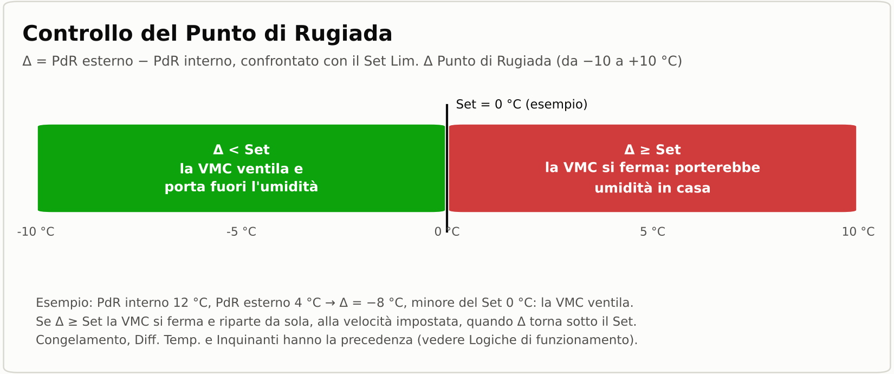

Il software calcola il Punto di Rugiada Esterno (PdR Ext.) e il Punto di Rugiada Interno (PdR Int.). Se la differenza tra il PdR Ext. e il PdR Int. è inferiore al "Set Lim. Δ Punto di Rugiada" (valore impostato dall'utente), la VMC garantirà un adeguato trasporto dell'umidità dall'interno all'esterno dell'edificio. Al contrario, se la differenza tra il PdR Ext. e il PdR Int. sarà maggiore o uguale al "Set Lim. Δ Punto di Rugiada", la VMC si arresterà per evitare il trasporto dell'umidità dall'esterno all'interno dell'edificio; la ripresa automatica sull'ultima velocità impostata è garantita non appena la differenza tra il PdR Ext. e il PdR Int. è inferiore al "Set Lim. Δ Punto di Rugiada". Le allerte con priorità maggiore (congelamento, Δ temperatura, inquinanti) prevalgono sul punto di rugiada: vedere "Logiche di funzionamento".

  

Permette l'utilizzo dei seguenti Servizi, da impiegare in qualsiasi Automazione, Script, etc.:

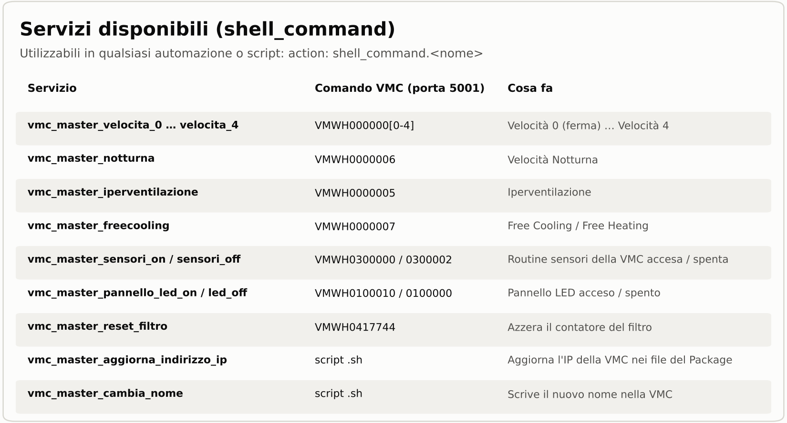

<strong>Scenario tipico</strong>

Un classico caso d'uso è un'abitazione con:
- VMC Helty Flow Plus o Flow Elite collegata alla rete di casa (app Air Guard)
- Home Assistant
- sensori di temperatura e umidità, interni ed esterni, oppure un servizio meteo
- un dispositivo mobile per le notifiche

**Risultato:** la VMC ventila quando serve, si ferma quando l'aria esterna porterebbe umidità, freddo o caldo indesiderati e riparte da sola alla velocità impostata.

  
<strong>Requisiti</strong>

- **[Home Assistant](https://www.home-assistant.io/installation/)**
- VMC **Helty Flow Plus** oppure **Flow Elite** visibile nell'app **[Air Guard](https://play.google.com/store/apps/details?id=com.helty.heltyair&hl=it&gl=US&pli=1)**; diversamente, inserirla nella rete di casa con la stessa app prima di procedere
- Indirizzo IP della VMC statico (impostato nel router); la VMC risponde sulla porta 5001
 

**App consigliata:** `File editor` [Impostazioni → Applicazioni → Installa app → File editor → Installa]

> ⚠️ **ATTENZIONE!** Se la VMC utilizza un'app diversa da **Air Guard**, il codice molto probabilmente non sarà compatibile 🧰.

<strong>Installazione</strong>

 

### Se è già installata una versione precedente
<strong>Dalla release 8.4.1 o precedenti:</strong> 
<strong>a)</strong> nella cartella `\\192.168.1.xxx\config\packages\vmc_helty_flow\master\` sostituire i file con quelli nuovi del punto <strong>4</strong>; i file `vmc_clona.yaml` e `vmc_clona_scheda_manuale_interfaccia.txt` non servono più: al primo avvio l'automazione «VMC Master - Clona Rimuovi File Obsoleti» li cancella da sola e chiede, con una notifica, di riavviare Home Assistant; 
<strong>b)</strong> sostituire l'automazione (punto <strong>5</strong>) e la scheda (punto <strong>6</strong>) con le nuove; cancellare dall'interfaccia la vecchia scheda «Clona VMC», ora sostituita dalla Finestra Clona del pannello Impostazioni; 
<strong>c)</strong> riavviare Home Assistant. 
Le VMC clonate restano alla release con cui sono state create: per aggiornarle, cancellarle dalla Finestra Clona, riavviare, clonarle di nuovo con lo stesso nome e IP, riavviare e incollare di nuovo automazione e scheda (punto <strong>11</strong>).

---

### 1. Rendere statico l'indirizzo IP della VMC
Impostare nel router un indirizzo IP statico per la VMC; la VMC risponde sulla porta <strong>5001</strong>.

---

### 2. Abilitare il caricamento dei package in Home Assistant
Verificare che nel file <strong>configuration.yaml</strong>, presente nella cartella <strong>config</strong> del server Home Assistant, sia riportata la seguente configurazione:

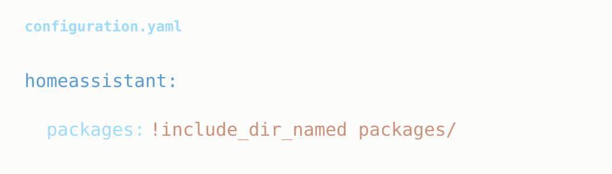

Se la configurazione non è presente, inserirla, salvare il file <strong>configuration.yaml</strong> e riavviare Home Assistant seguendo il percorso:
<strong>Impostazioni → Strumenti → YAML → Riavvia → Altre opzioni → Riavvio del sistema</strong>.

---

### 3. Creare la cartella del package
Verificare la presenza della cartella <strong>packages</strong> all'interno della cartella <strong>config</strong> del server Home Assistant.

Se la cartella non è presente, creare l'intero percorso:

<pre style="font-size:10px; background-color: #d9ffcc;">
\\192.168.1.xxx\config\packages\vmc_helty_flow\master
</pre>

L'operazione può essere eseguita, ad esempio, tramite l'app <strong>File editor</strong>.

---

### 4. Copiare i file del package
All'interno del percorso `\\192.168.1.xxx\config\packages\vmc_helty_flow\master`, copiare i seguenti file scaricabili dal repository GitHub tramite <strong>Code → Download ZIP</strong>:

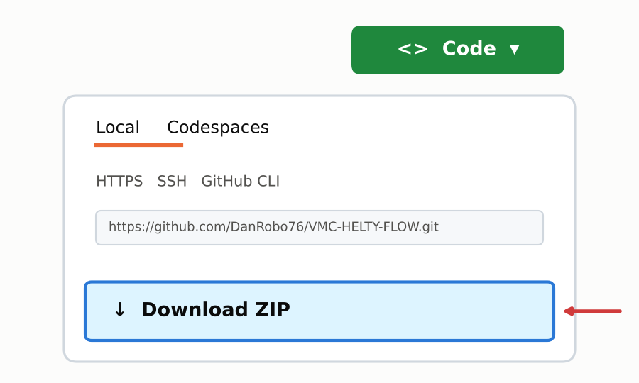

<pre style="font-size:10px; background-color: #d9ffcc;">
- vmc_master.yaml
- vmc_master_automazione.txt
- vmc_master_scheda_manuale_interfaccia.txt
- vmc_master_script_cambio_ip.sh
- vmc_master_script_cambio_nome.sh
- vmc_script_clona.sh
</pre>

Il file `vmc_script_clona.sh` serve alla Finestra Clona per creare le VMC aggiuntive (punto <strong>11</strong>); va copiato anche se oggi si dispone di una sola VMC.

---

### 5. Importare l'automazione
In Home Assistant seguire il percorso:

<strong>Impostazioni → Automazioni e scenari → Crea automazione → Crea una nuova automazione</strong>

Successivamente:
- cliccare in alto a destra sui <strong>tre puntini</strong>;
- selezionare <strong>Modifica in YAML</strong>;
- eliminare il contenuto presente;
- incollare il contenuto del file <strong>vmc_master_automazione.txt</strong>;
- salvare l'automazione.

---

### 6. Importare la scheda Lovelace
Aprire la plancia in cui inserire la scheda. Nelle nuove installazioni la plancia <strong>Panoramica</strong> è generata automaticamente: in questo caso creare prima una plancia da <strong>Impostazioni → Plance → Aggiungi plancia → Nuova plancia da zero</strong>.

Nella plancia seguire il percorso:

<strong>icona matita (Modifica la plancia) → Aggiungi scheda → Manuale</strong>

Successivamente:
- selezionare tutto il codice già presente;
- eliminarlo;
- incollare il contenuto del file <strong>vmc_master_scheda_manuale_interfaccia.txt</strong>;
- salvare la scheda.

---

### 7. Riavviare Home Assistant
<strong>Impostazioni → Strumenti → YAML → Riavvia → Riavvia Home Assistant</strong>.

---

### 8. Inserire l'indirizzo IP della VMC
Nella scheda aprire il pannello <strong>Impostazioni</strong> e scrivere l'indirizzo IP della VMC (vedere il punto 1) nel campo <strong>«Cambia IP VMC (Riavvio di H.A.)»</strong>: l'IP viene aggiornato in tutti i file del Package e Home Assistant si riavvia da solo. Un IP non valido viene cancellato.

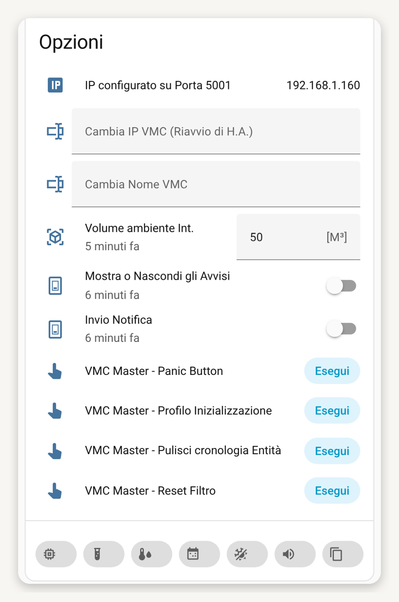

---

### 9. Eseguire il Profilo Inizializzazione
Nello stesso pannello premere <strong>Esegui</strong> su <strong>«VMC Master - Profilo Inizializzazione»</strong> e confermare con <strong>OK</strong> nel popup «Vuoi Procedere?». Da eseguire solo la prima volta: attiva i profili predefiniti, azzera gli offset dei sensori e le variabili, arresta la VMC e, al termine del processo, riavvia Home Assistant.

---

### 10. Pannello Informazioni
Per maggiori informazioni aprire il <strong>Pannello Informazioni</strong> della scheda: 24 voci illustrate spiegano ogni funzione, i valori impostabili e le logiche.

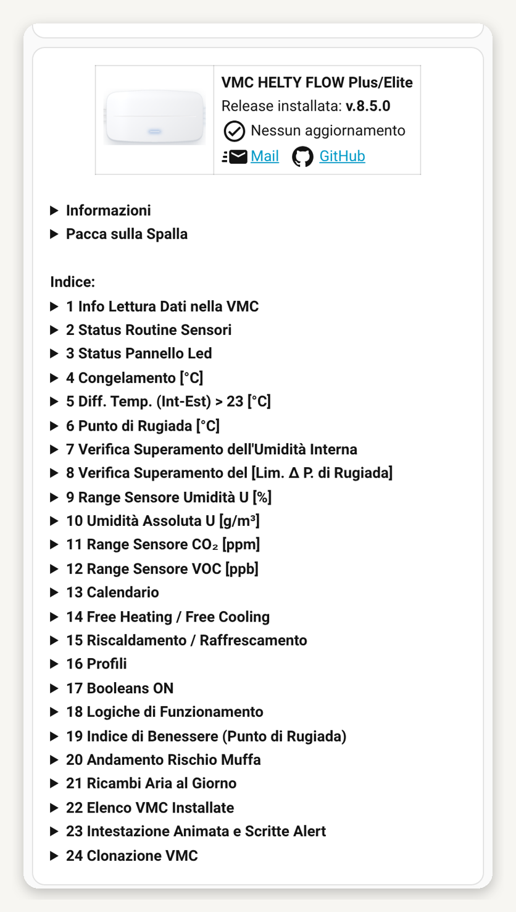

---

### 11. Se si dispone di più VMC
Nella VMC Master aprire il pannello <strong>Impostazioni</strong> e premere l'icona della <strong>Finestra Clona</strong>, accanto alla Finestra Audio:
- scrivere il <strong>Nome VMC</strong> (solo lettere minuscole, da 1 a 10 caratteri) e l'<strong>IP VMC su Porta 5001</strong>; se un dato non è corretto o è già in uso compaiono le regole o l'avviso;
- premere <strong>«Clona VMC ‹nome›»</strong> e confermare: viene creata la cartella `\\192.168.1.xxx\config\packages\vmc_helty_flow\‹nome›` con i file della nuova VMC;
- copiare il contenuto dei due file .txt indicati nel riquadro «VMC Clonata» in una nuova automazione e in una nuova scheda (come ai punti <strong>5</strong> e <strong>6</strong>);
- per un'altra VMC premere <strong>«Ripeti Clona/Elimina VMC»</strong>; terminate le clonazioni premere <strong>«Riavvia Home Assistant»</strong>.

Per cancellare una VMC scrivere il suo nome nella Finestra Clona, premere <strong>«Cancella VMC ‹nome›»</strong> e confermare con <strong>«Sì, cancella ‹nome›»</strong>; poi cancellare a mano la sua automazione e la sua scheda e riavviare. Dettagli nel Pannello Informazioni, voce 24.

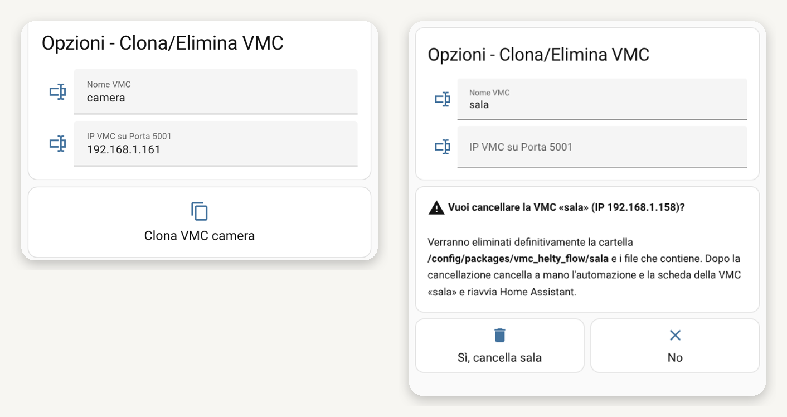

---

### 12. Verifica finale
Al termine dell'installazione:
- verificare che il package sia stato caricato correttamente;
- verificare la presenza dell'automazione importata;
- verificare la corretta visualizzazione della scheda in dashboard e lo stato della VMC.

> **Attenzione:** se la VMC non viene vista, assicurarsi che sia visualizzata nell'app **Air Guard**; diversamente, utilizzando la stessa, inserirla nella rete di casa.

<strong>Configurazione</strong>

La configurazione avviene direttamente dalla scheda dell'interfaccia:
- indirizzo IP e nome della VMC («Cambia IP VMC (Riavvio di H.A.)» e «Cambia Nome VMC»);
- selezione delle entità: Temperatura (interna ed esterna), Umidità (interna ed esterna), CO₂ interna, Dispositivo Mobile e Media Player;
- offset dei sensori;
- `Set Lim. Δ Punto di Rugiada` e Condizione Climatica Esterna;
- calendario (2 fasce orarie per ogni giorno) e mesi di Free Heating / Free Cooling;
- interruttori ON/OFF di ogni funzione: inquinanti, punto di rugiada, Free Cooling, Free Heating, umidità, calendario;
- notifiche audio: Media Player, volume, orari e categorie di allerta;
- clonazione e cancellazione delle VMC (Finestra Clona).

Ogni script chiede conferma con il popup «Vuoi Procedere?». Questo consente di cambiare dispositivi e impostazioni senza modificare manualmente lo YAML. Per i dettagli aprire il **Pannello Informazioni** della scheda.

<strong>Logiche di funzionamento</strong>

La tabella riassume priorità, comportamento della VMC e tempi di intervento di ogni allerta. Il dettaglio completo è nel Pannello Informazioni, voce 18.

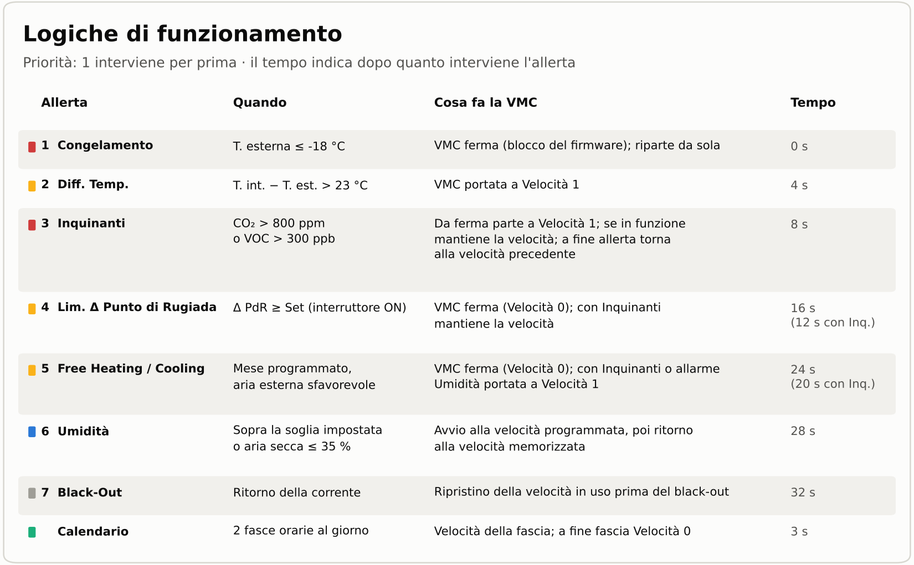

<strong>Schermate</strong>

Le schermate possono variare in funzione dell'ultima versione rilasciata.

<strong>Licenza</strong>

**[PolyForm Noncommercial 1.0.0](https://polyformproject.org/licenses/noncommercial/1.0.0)**. Copyright © 2023-2026 Ing. Danilo Robotti. È consentito usare, copiare, modificare e distribuire il software esclusivamente per scopi non commerciali; chi lo distribuisce, anche modificato, deve includere il testo della licenza (o il suo indirizzo) e la riga:

`Required Notice: Copyright © 2023-2026 Ing. Danilo Robotti (https://github.com/DanRobo76/VMC-HELTY-FLOW)`

Qualsiasi uso commerciale richiede una licenza separata dell'autore.

**Impiego dell'Intelligenza Artificiale:** nello sviluppo del software l'autore si è avvalso anche di strumenti di intelligenza artificiale.

<strong>Esonero di responsabilità</strong>

Il software è fornito «così com'è», senza garanzie di alcun tipo. In nessun caso lo sviluppatore sarà responsabile di danneggiamenti diretti, indiretti o conseguenti, correlati a difetti del presente software. L'utente ha l'onere e la responsabilità della scelta, dell'installazione, dell'uso e della gestione del software al fine del raggiungimento del risultato prefissatosi.

<strong><a href="SECURITY.md">Limiti del software (Security Policy)</a></strong>

---

  Se il progetto ti è stato utile, puoi
  <a href="https://www.paypal.com/ncp/payment/8LT4JJW7MHW6U">
    offrirmi un ginseng ☕ e supportarne lo sviluppo
  </a>.
    
  Clicca sul link oppure scansiona il QR code qui sotto.
    
  
    
  Grazie per il tuo supporto!

  
🇺🇸 <strong>ENGLISH (Click to expand)</strong>

<h1 align="center">
  VMC MASTER
  
  
</h1>

  <strong>Your mechanical ventilation, controlled in Home Assistant.</strong> 
  Advanced package for Helty Flow Plus / Elite MVHR units: prioritized logic, local and remote control, reliable alerts.

  <a href="mailto:danilo.robotti@gmail.com">danilo.robotti@gmail.com</a>

  Have you tried <strong><a href="https://github.com/DanRobo76/Aspiratore">ASPIRATORE MASTER</a></strong> and <strong><a href="https://github.com/DanRobo76/VMC-HELTY-FLOW-LIGHT/tree/main">VMC Light Version</a></strong>?

---

<strong>Why VMC MASTER</strong>

**VMC MASTER** is an advanced Home Assistant package designed to manage **Helty Flow Plus / Elite** ventilation units (managed with the Air Guard app), both locally and remotely.
 
It is not just a remote control, but an evolved logic that continuously compares indoor and outdoor conditions (temperature, humidity, dew point, pollutants) and decides whether and at which speed the unit should run, with precise priorities between alerts and automatic return to the set speed.

<strong>What makes it different</strong>

| Function | Advantage |
|---|---|
| **Prioritized logic** | Freezing, temperature Δ, pollutants, dew point, Free Cooling / Free Heating, humidity and power failure handled in a precise order, with automatic recovery |
| **Dew point control** | The unit stops when it would bring outdoor humidity indoors |
| **Free Cooling / Free Heating** | No unwanted cooling or heating in the scheduled months; free warm or cool air when it pays off |
| **Air quality** | Start and stop based on CO₂ and VOC (Flow Elite sensors; CO₂ also from a Home Assistant entity) |
| **Indoor humidity control** | Automatic start at the scheduled speed, also with dry air (≤ 35%), and return to the stored speed |
| **Calendar** | 2 time slots for each day of the week and 2 monthly periods |
| **Dynamic entity selection** | Home Assistant sensors and weather services instead of the unit's own sensors, with offsets |
| **Animated header** | The airflow moves according to the flow rate and the LED colour shows the state: white normal, yellow alert, blue humidity, red pollutants, grey off-line; the «Alert» label under the buttons warns before starting the unit |
| **Alerts and notifications** | On mobile devices and through Media Players |
| **Multiple units** | Cloning and deletion from the Clone window of the Settings panel, with no restarts in between |

<strong>Main Benefits</strong>

- Configuration from the interface, without editing YAML
- Local and remote control of the unit
- Automatic return to the set speed at the end of every alert
- Speed recovery after a power failure (unit on a dedicated circuit and/or smart relay)
- Calculation of air changes, airflow, absolute humidity and hygrometric comfort
- Change of the unit's IP address and name from the interface
- Confirmation before every script («Vuoi Procedere?» – Do you want to proceed?); «Yes / No» confirmation for history purge and unit deletion
- Information Panel with 24 illustrated items explaining every function
- Notice when a new update is available

<strong>Full feature list</strong>

- Choose which alerts to hear through the selected Media Player.
- Select Media Player entities to hear the alert status and the speed.
- Mould risk trend indicator.
- Indicator that converts the dew point into a qualitative classification of indoor hygrometric comfort.
- Shows in real time: the total number of air changes made during the day, the total volume of exchanged air (m³) and the time left before the next complete air change [Click on Remote control].
- Lists all installed units in one table, one column per unit [Information Panel → item 22].
- Animated header: airflow proportional to the flow rate and LED colour according to the state; «Alert», «Alert Δ Temp.» and «Alert Free» labels under the speed buttons when an alert would block or reduce the unit [Information Panel → item 23].
- Select the Home Assistant entities for: Temperature (Indoor and Outdoor), Humidity (Indoor and Outdoor), Carbon Dioxide CO₂ (Indoor) and Mobile Device, including entities from weather sources, for greater precision and reliability than the unit's built-in sensors.
- Notifies the user on the Mobile Device when the unit starts, stops, reports errors or needs a filter change.
- Automatic start and stop based on pollutants (CO₂ and/or VOC) [unit sensors only on the HELTY FLOW ELITE; for CO₂ a Home Assistant entity can also be selected].
- Automatic start and stop based on the set Indoor Humidity (above the set value, or with dry air ≤ 35% to bring in outdoor air).
- With more than one unit, clone and delete units from the Clone window of the Settings panel, available only on the Master unit: name and IP checks, several clones without restarting, deletion with «Yes / No» confirmation (see Installation, step 11).
- At the first start after updating from release 8.4.1 or earlier, it deletes by itself the files of the old Clone VMC (vmc_clona.yaml and vmc_clona_scheda_manuale_interfaccia.txt).
- Automatic stop when the Outdoor Temperature is ≤ -18 °C and restart according to the set offsets.
  > **Note:** by firmware design, the unit's internal sensor takes priority over the value of the selected outdoor sensor entity.
- Automatic start at Speed 1 when the Indoor - Outdoor Temperature Difference is > 23 °C, and restart afterwards.
  > **Note:** by firmware design, the unit's internal sensors take priority over the values of the selected outdoor sensor entity.
- Change the unit's IP from the user interface («Cambia IP VMC (Riavvio di H.A.)» – Change unit IP, Home Assistant restart).
- Rename the unit from the user interface («Cambia Nome VMC» – Change unit name).
- Remote and local control of the unit.
- Start and stop according to 2 programmable time slots for each day of the week.
- Start and stop according to 2 programmable monthly periods (Free Heating / Free Cooling), avoiding unwanted cooling or heating.
- Start and stop according to environmental parameters.
- Restores the speed after a power failure (if the unit has a dedicated circuit and/or a smart relay is installed).
- Calculates the air change time according to the speed.
- Calculates the airflow (m³/h) according to the speed.
- Calculates outdoor and indoor absolute humidity (g/m³).
- Purges the history of the package entities, first showing in a confirmation box the number and the list of the entities involved.
- Shows alerts based on:
  - CO₂ and/or VOC sensors;
  - humidity sensor;
  - freezing;
  - difference between indoor and outdoor temperature;
  - exceeding the Dew Point Δ Limit set;
  - unwanted heating or cooling (Free Heating / Free Cooling).
- Notifies when a new update is available.
- Select the "Outdoor Climate Condition" through the "Dew Point Δ Limit" set.

 

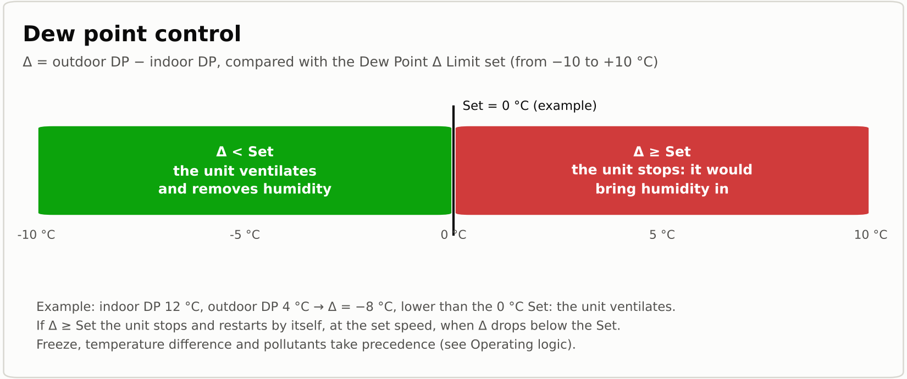

The software calculates the Outdoor Dew Point (DP Ext.) and the Indoor Dew Point (DP Int.). If the difference between DP Ext. and DP Int. is lower than the "Dew Point Δ Limit" (value set by the user), the unit ensures proper transport of humidity from inside to outside the building. Conversely, if the difference between DP Ext. and DP Int. is greater than or equal to the "Dew Point Δ Limit", the unit stops to avoid bringing humidity from outside into the building; automatic restart at the last set speed is guaranteed as soon as the difference drops below the "Dew Point Δ Limit". Higher-priority alerts (freezing, temperature Δ, pollutants) prevail over the dew point: see "Operating Logic".

  

The following Services can be used in any Automation, Script, etc.:

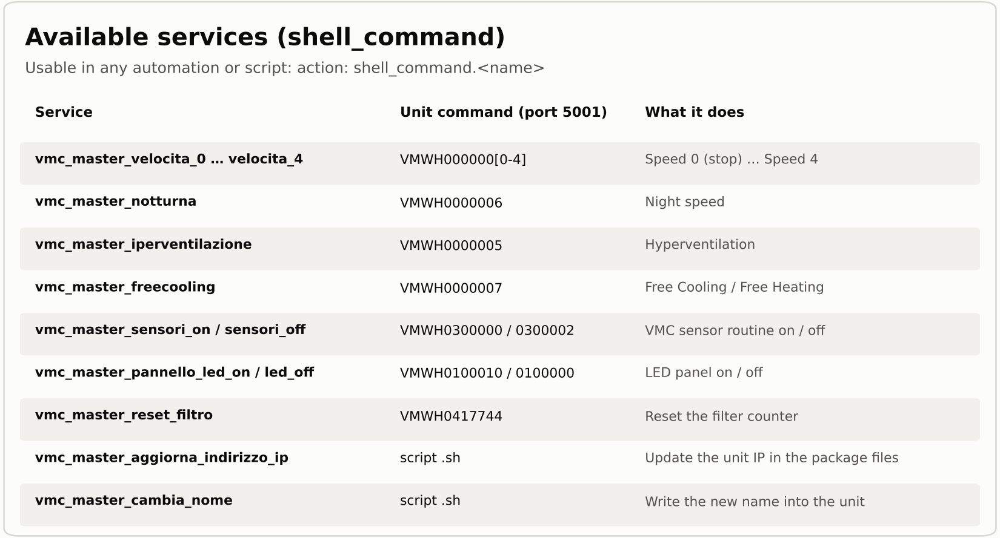

<strong>Typical Scenario</strong>

A typical use case is a home with:
- a Helty Flow Plus or Flow Elite unit connected to the home network (Air Guard app)
- Home Assistant
- indoor and outdoor temperature and humidity sensors, or a weather service
- a mobile device for notifications

**Result:** the unit ventilates when needed, stops when outdoor air would bring unwanted humidity, cold or heat, and restarts by itself at the set speed.

  
<strong>Requirements</strong>

- **[Home Assistant](https://www.home-assistant.io/installation/)**
- **Helty Flow Plus** or **Flow Elite** unit visible in the **[Air Guard](https://play.google.com/store/apps/details?id=com.helty.heltyair&hl=it&gl=US&pli=1)** app; otherwise add it to the home network with the same app before proceeding
- Static IP address for the unit (set in the router); the unit answers on port 5001
 

**Recommended app:** `File editor` [Settings → Apps → Install app → File editor → Install]

> ⚠️ **WARNING!** If the unit uses an app other than **Air Guard**, the code will most likely not be compatible 🧰.

<strong>Installation</strong>

 

### If a previous version is already installed
<strong>From release 8.4.1 or earlier:</strong> 
<strong>a)</strong> in the folder `\\192.168.1.xxx\config\packages\vmc_helty_flow\master\` replace the files with the new ones of step <strong>4</strong>; the files `vmc_clona.yaml` and `vmc_clona_scheda_manuale_interfaccia.txt` are no longer needed: at the first start the automation «VMC Master - Clona Rimuovi File Obsoleti» deletes them by itself and asks, with a notification, to restart Home Assistant; 
<strong>b)</strong> replace the automation (step <strong>5</strong>) and the card (step <strong>6</strong>) with the new ones; delete the old «Clona VMC» card from the interface, now replaced by the Clone window of the Settings panel; 
<strong>c)</strong> restart Home Assistant. 
Cloned units stay at the release they were created with: to update them, delete them from the Clone window, restart, clone them again with the same name and IP, restart and paste automation and card again (step <strong>11</strong>).

---

### 1. Make the unit's IP address static
Set a static IP address for the unit in the router; the unit answers on port <strong>5001</strong>.

---

### 2. Enable package loading in Home Assistant
Check that the <strong>configuration.yaml</strong> file, in the <strong>config</strong> folder of the Home Assistant server, contains the following configuration:

If it is missing, add it, save <strong>configuration.yaml</strong> and restart Home Assistant through:
<strong>Settings → Developer tools → YAML → Restart → Advanced options → Restart system</strong>.

---

### 3. Create the package folder
Check that the <strong>packages</strong> folder exists inside the <strong>config</strong> folder of the Home Assistant server.

If it does not exist, create the whole path:

<pre style="font-size:10px; background-color: #d9ffcc;">
\\192.168.1.xxx\config\packages\vmc_helty_flow\master
</pre>

This can be done, for example, with the <strong>File editor</strong> app.

---

### 4. Copy the package files
Inside `\\192.168.1.xxx\config\packages\vmc_helty_flow\master`, copy the following files, downloadable from the GitHub repository through <strong>Code → Download ZIP</strong>:

<pre style="font-size:10px; background-color: #d9ffcc;">
- vmc_master.yaml
- vmc_master_automazione.txt
- vmc_master_scheda_manuale_interfaccia.txt
- vmc_master_script_cambio_ip.sh
- vmc_master_script_cambio_nome.sh
- vmc_script_clona.sh
</pre>

The `vmc_script_clona.sh` file is used by the Clone window to create additional units (step <strong>11</strong>); copy it even if you have only one unit today.

---

### 5. Import the automation
In Home Assistant go to:

<strong>Settings → Automations & scenes → Create automation → Create new automation</strong>

Then:
- click the <strong>three dots</strong> at the top right;
- select <strong>Edit in YAML</strong>;
- delete the existing content;
- paste the content of the <strong>vmc_master_automazione.txt</strong> file;
- save the automation.

---

### 6. Import the Lovelace card
Open the dashboard where you want the card. In new installations the <strong>Overview</strong> dashboard is generated automatically: in this case first create a dashboard from <strong>Settings → Dashboards → Add dashboard → New dashboard from scratch</strong>.

In the dashboard go to:

<strong>pencil icon (Edit dashboard) → Add card → Manual</strong>

Then:
- select all the existing code;
- delete it;
- paste the content of the <strong>vmc_master_scheda_manuale_interfaccia.txt</strong> file;
- save the card.

---

### 7. Restart Home Assistant
<strong>Settings → Developer tools → YAML → Restart → Restart Home Assistant</strong>.

---

### 8. Enter the unit's IP address
In the card open the <strong>Settings</strong> panel and type the unit's IP address (see step 1) in the <strong>«Cambia IP VMC (Riavvio di H.A.)»</strong> field: the IP is updated in all the package files and Home Assistant restarts by itself. An invalid IP is cleared.

---

### 9. Run the Initialisation Profile
In the same panel press <strong>Esegui</strong> (Run) on <strong>«VMC Master - Profilo Inizializzazione»</strong> and confirm with <strong>OK</strong> in the «Vuoi Procedere?» popup. Run it only the first time: it enables the default profiles, resets the sensor offsets and the variables, stops the unit and, when the process ends, restarts Home Assistant.

---

### 10. Information Panel
For more details open the card's <strong>Information Panel</strong>: 24 illustrated items explain every function, the settable values and the logic.

---

### 11. With more than one unit
On the Master unit open the <strong>Settings</strong> panel and press the <strong>Clone window</strong> icon, next to the Audio window:
- type the <strong>Nome VMC</strong> (unit name: lowercase letters only, 1 to 10 characters) and the <strong>IP VMC su Porta 5001</strong> (unit IP on port 5001); if a value is not valid or already in use, the rules or a warning appear;
- press <strong>«Clona VMC ‹name›»</strong> and confirm: the folder `\\192.168.1.xxx\config\packages\vmc_helty_flow\‹name›` is created with the files of the new unit;
- copy the content of the two .txt files shown in the «VMC Clonata» box into a new automation and a new card (as in steps <strong>5</strong> and <strong>6</strong>);
- for another unit press <strong>«Ripeti Clona/Elimina VMC»</strong> (repeat); when done press <strong>«Riavvia Home Assistant»</strong> (restart).

To delete a unit type its name in the Clone window, press <strong>«Cancella VMC ‹name›»</strong> and confirm with <strong>«Sì, cancella ‹name›»</strong> (yes, delete); then delete its automation and card by hand and restart. Details in the Information Panel, item 24.

---

### 12. Final Verification
After the installation:
- check that the package has been loaded correctly;
- check that the imported automation is present;
- check that the card is shown correctly in the dashboard together with the unit status.

> **Warning:** if the unit is not found, make sure it is shown in the **Air Guard** app; otherwise add it to the home network with the same app.

<strong>Configuration</strong>

Configuration is done directly from the interface card:
- unit IP address and name («Cambia IP VMC (Riavvio di H.A.)» and «Cambia Nome VMC»);
- entity selection: Temperature (indoor and outdoor), Humidity (indoor and outdoor), indoor CO₂, Mobile Device and Media Player;
- sensor offsets;
- `Dew Point Δ Limit` set and Outdoor Climate Condition;
- calendar (2 time slots per day) and Free Heating / Free Cooling months;
- ON/OFF switches for each function: pollutants, dew point, Free Cooling, Free Heating, humidity, calendar;
- audio notifications: Media Player, volume, time window and alert categories;
- cloning and deletion of units (Clone window).

Every script asks for confirmation with the «Vuoi Procedere?» popup. Devices and settings can be changed without editing YAML by hand. For details open the card's **Information Panel**.

<strong>Operating Logic</strong>

The table summarises priority, unit behaviour and reaction time of each alert. Full details are in the Information Panel, item 18.

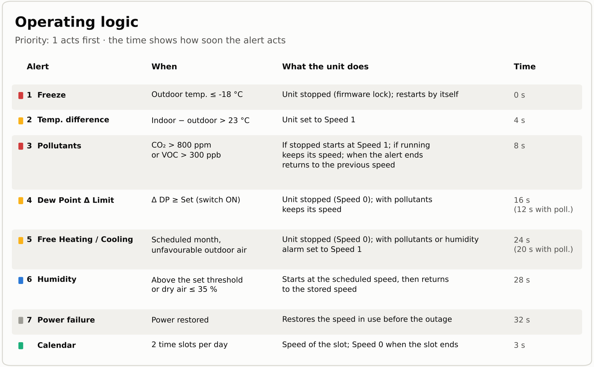

<strong>Screenshots</strong>

Screenshots may change with the latest release. The interface of the card is in Italian.

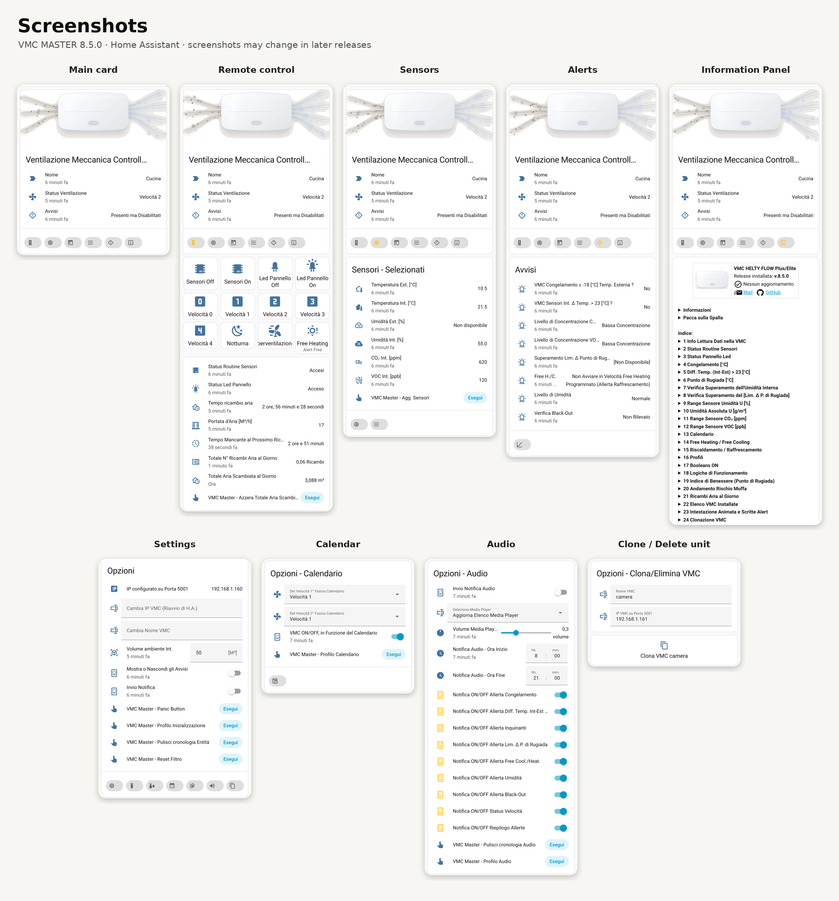

<strong>License</strong>

**[PolyForm Noncommercial 1.0.0](https://polyformproject.org/licenses/noncommercial/1.0.0)**. Copyright © 2023-2026 Ing. Danilo Robotti. You may use, copy, modify and distribute the software for noncommercial purposes only; whoever distributes it, even modified, must include the license text (or its address) and the line:

`Required Notice: Copyright © 2023-2026 Ing. Danilo Robotti (https://github.com/DanRobo76/VMC-HELTY-FLOW)`

Any commercial use requires a separate license from the author.

**Use of Artificial Intelligence:** in developing the software the author also used artificial intelligence tools.

<strong>Disclaimer</strong>

The software is provided "as is", without warranties of any kind. In no event shall the developer be liable for direct, indirect or consequential damages related to defects of this software. The user is solely responsible for choosing, installing, using and managing the software to achieve the intended result.

<strong><a href="SECURITY.md">Software limits (Security Policy)</a></strong>

---

  If this project was useful to you, you can
  <a href="https://www.paypal.com/ncp/payment/8LT4JJW7MHW6U">
    buy me a ginseng ☕ and support its development
  </a>.
    
  Click the link or scan the QR code below.
    
  
    
  Thank you for your support!

