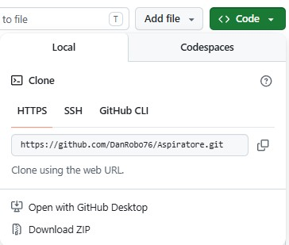

  

---

  <strong>Scegli la lingua / Choose your language:</strong>

  
🇮🇹 <strong>ITALIANO (Clicca per espandere)</strong>

<h1 align="center">
  VMC MASTER
  
  
</h1>

  <strong>La tua ventilazione meccanica controllata in Home Assistant.</strong> 
  Package avanzato per VMC Helty Flow Plus / Elite: logiche con priorità, controllo locale e remoto, avvisi affidabili.

  <a href="mailto:danilo.robotti@gmail.com">danilo.robotti@gmail.com</a>

  Hai già provato <strong><a href="https://github.com/DanRobo76/Aspiratore">ASPIRATORE MASTER</a></strong> e <strong><a href="https://github.com/DanRobo76/VMC-HELTY-FLOW-LIGHT/tree/main">VMC Versione Light</a></strong>?

---

<strong>Perché VMC MASTER</strong>

**VMC MASTER** è un package avanzato per Home Assistant progettato per la gestione delle VMC **Helty Flow Plus / Elite** (gestite con l'app Air Guard), sia in locale sia da remoto.
 
Non è un semplice telecomando, ma una logica evoluta che confronta in continuo le condizioni interne ed esterne (temperatura, umidità, punto di rugiada, inquinanti) e decide se e a quale velocità far funzionare la VMC, con priorità precise tra le allerte e la ripresa automatica della velocità impostata.

<strong>Cosa lo rende diverso</strong>

| Funzione | Vantaggio |
|---|---|
| **Logiche con priorità** | Congelamento, Δ temperatura, inquinanti, punto di rugiada, Free Cooling / Free Heating, umidità e black-out gestiti in un ordine preciso, con ripresa automatica |
| **Controllo del punto di rugiada** | La VMC si arresta quando porterebbe in casa umidità dall'esterno |
| **Free Cooling / Free Heating** | Nessun raffrescamento o riscaldamento indesiderato nei mesi programmati |
| **Qualità dell'aria** | Avvio e arresto in funzione di CO₂ e VOC (sensori della VMC Flow Elite; CO₂ anche da un'entità di Home Assistant) |
| **Controllo dell'umidità interna** | Avvio automatico alla velocità programmata, anche con aria secca (≤ 35%), e ritorno alla velocità memorizzata |
| **Calendario** | 2 fasce orarie per ogni giorno della settimana e 2 fasce mensili |
| **Selezione dinamica delle entità** | Sensori di Home Assistant e servizi meteo al posto dei sensori della VMC, con offset |
| **Avvisi e notifiche** | Su dispositivo mobile e tramite Media Player |
| **Più VMC** | Clonazione direttamente dall'interfaccia |

<strong>Vantaggi principali</strong>

- Configurazione dall'interfaccia, senza modificare lo YAML
- Controllo locale e remoto della VMC
- Ripresa automatica della velocità al termine di ogni allerta
- Ripristino della velocità dopo un black-out (VMC con linea dedicata nel quadro elettrico e/o relè domotico)
- Calcolo di ricambi d'aria, portata, umidità assoluta e comfort igrometrico
- Cambio dell'indirizzo IP e del nome della VMC dall'interfaccia
- Avviso quando è disponibile un nuovo aggiornamento

<strong>Funzionalità complete</strong>

- Permette di selezionare quali Avvisi ascoltare tramite il Media Player selezionato.
- Permette di selezionare le entità Media Player, per ascoltare lo stato degli Avvisi e la Velocità.
- Indicatore Andamento Rischio Muffa.
- Indicatore che converte il punto di rugiada (TPdR) in una classificazione qualitativa del comfort igrometrico all'interno dell'ambiente.
- Visualizza in tempo reale: il numero totale di ricambi d'aria effettuati nella giornata, il volume totale di aria scambiata (m³) e il tempo rimanente prima del prossimo ricambio completo [Cliccare su Telecomando].
- Elenca tutte le VMC installate e relativi parametri correlati [Cliccare su Informazioni → Punto 22].
- Permette di selezionare le entità di: Temperatura (Interna ed Esterna), Umidità (Interna ed Esterna), Anidride Carbonica CO₂ (Interna) e Dispositivo Mobile, disponibili in Home Assistant, includendo anche le entità provenienti da fonti Meteo, per ottenere maggiore precisione e affidabilità rispetto ai sensori integrati della VMC.
- Avvisa l'utente tramite notifica sul Dispositivo Mobile in caso di Avvio, Arresto, Errori o cambio filtro della VMC.
- Permette l'accensione e lo spegnimento automatico in funzione degli inquinanti (CO₂ e/o VOC) [sensori della VMC presenti solo nella VMC HELTY FLOW ELITE; per la CO₂ si può selezionare anche un'entità di Home Assistant].
- Permette l'accensione e lo spegnimento automatico in funzione dell'Umidità Interna Settata (sopra il valore impostato, oppure con aria secca ≤ 35% per far entrare aria dall'esterno) [opzione esclusa nell'intervallo del calendario].
- Se si dispone di più VMC, permette di clonarle direttamente dall'interfaccia utente (vedi Installazione, punto 9).
- Permette lo spegnimento automatico in funzione della Temperatura Esterna ≤ -18 °C e successiva ripresa in funzione degli offset impostati.
  > **Nota:** per impostazione firmware, la priorità è assegnata al sensore interno della VMC rispetto al valore rilevato dal sensore esterno dell'entità selezionata.
- Permette l'avvio automatico a Velocità 1 in funzione della Differenza Temperatura Interna - Temperatura Esterna se > 23 °C e successiva ripresa.
  > **Nota:** per impostazione firmware, la priorità è assegnata ai sensori interni della VMC rispetto ai valori rilevati dal sensore esterno dell'entità selezionata.
- Permette di cambiare l'IP della VMC dall'interfaccia utente.
- Permette di rinominare la VMC dall'interfaccia utente.
- Permette il controllo remoto e locale della VMC.
- Permette l'accensione e lo spegnimento in funzione di 2 fasce orarie programmabili per ogni giorno della settimana.
- Permette l'accensione e lo spegnimento in funzione di 2 fasce mensili programmabili (Free Heating / Free Cooling), evitando raffrescamento o riscaldamento indesiderato.
- Permette l'accensione e lo spegnimento in funzione dei parametri ambientali.
- Ripristina la velocità in caso di Black-Out (se la VMC ha linea dedicata al quadro elettrico e/o è installato un relè domotico) [opzione esclusa nell'intervallo del calendario].
- Calcola il tempo di ricambio d'aria in funzione della velocità.
- Calcola la portata d'aria (m³/h) in funzione della velocità.
- Calcola l'umidità assoluta esterna e interna (g/m³).
- Mostra avvisi in funzione di:
  - sensori CO₂ e/o VOC;
  - sensore umidità;
  - congelamento;
  - differenza tra temperatura interna ed esterna;
  - superamento del Set Lim. Δ Punto di Rugiada;
  - riscaldamento o raffrescamento indesiderato (Free Heating / Free Cooling).
- Informa in caso di nuovo aggiornamento disponibile.
- Permette di selezionare la "Condizione Climatica Esterna" da introdurre tramite il "Set Lim. Δ Punto di Rugiada".

 

Il software calcola il Punto di Rugiada Esterno (PdR Ext.) e il Punto di Rugiada Interno (PdR Int.). Se la differenza tra il PdR Ext. e il PdR Int. è inferiore al "Set Lim. Δ Punto di Rugiada" (valore impostato dall'utente), la VMC garantirà un adeguato trasporto dell'umidità dall'interno all'esterno dell'edificio. Al contrario, se la differenza tra il PdR Ext. e il PdR Int. sarà maggiore o uguale al "Set Lim. Δ Punto di Rugiada", la VMC si arresterà per evitare il trasporto dell'umidità dall'esterno all'interno dell'edificio; la ripresa automatica sull'ultima velocità impostata è garantita non appena la differenza tra il PdR Ext. e il PdR Int. è inferiore al "Set Lim. Δ Punto di Rugiada". Le allerte con priorità maggiore (congelamento, Δ temperatura, inquinanti) prevalgono sul punto di rugiada: vedere la tabella "Logiche di funzionamento".

  

Permette l'utilizzo dei seguenti Servizi, da impiegare in qualsiasi Automazione, Script, etc.:

<strong>Scenario tipico</strong>

Un classico caso d'uso è un'abitazione con:
- VMC Helty Flow Plus o Flow Elite collegata alla rete di casa (app Air Guard)
- Home Assistant
- sensori di temperatura e umidità, interni ed esterni, oppure un servizio meteo
- un dispositivo mobile per le notifiche

**Risultato:** la VMC ventila quando serve, si ferma quando l'aria esterna porterebbe umidità, freddo o caldo indesiderati e riparte da sola alla velocità impostata.

  
<strong>Requisiti</strong>

- **[Home Assistant](https://www.home-assistant.io/installation/)**
- VMC **Helty Flow Plus** oppure **Flow Elite** visibile nell'app **[Air Guard](https://play.google.com/store/apps/details?id=com.helty.heltyair&hl=it&gl=US&pli=1)**; diversamente, inserirla nella rete di casa con la stessa app prima di procedere
- Indirizzo IP della VMC statico (impostato nel router); la VMC risponde sulla porta 5001
 

**App consigliata:** `File editor` [Impostazioni → Applicazioni → Installa app → File editor → Installa]

> ⚠️ **ATTENZIONE!** Se la VMC utilizza un'app diversa da **Air Guard**, il codice molto probabilmente non sarà compatibile 🧰.

<strong>Installazione</strong>

 

### Se è già installata una versione precedente
<strong>a)</strong> Cancellare tutto il contenuto della cartella `\\192.168.1.xxx\config\packages\vmc_helty_flow\`, oppure seguire il punto <strong>4.2</strong>, inserire l'indirizzo IP e la cartella dove è installato il software della VMC da cancellare (punto <strong>9</strong>) e cliccare su "VMC Master - Cancella VMC"; 
<strong>b)</strong> aprire la plancia che contiene la/e scheda/e VMC → cliccare in alto a destra sull'<strong>icona matita (Modifica la plancia)</strong> → cliccare sui <strong>tre puntini</strong> della/e scheda/e VMC → <strong>Elimina</strong> → <strong>Fatto</strong>; 
<strong>c)</strong> andare in <strong>Impostazioni → Automazioni e scenari</strong> → cliccare sui <strong>tre puntini</strong> della/e automazione/i VMC → <strong>Elimina</strong>; 
<strong>d)</strong> riavviare Home Assistant.

---

### 1. Rendere statico l'indirizzo IP della VMC
Impostare nel router un indirizzo IP statico per la VMC; la VMC risponde sulla porta <strong>5001</strong>.

---

### 2. Abilitare il caricamento dei package in Home Assistant
Verificare che nel file <strong>configuration.yaml</strong>, presente nella cartella <strong>config</strong> del server Home Assistant, sia riportata la seguente configurazione:

<pre style="font-size:10px; background-color: #d9ffcc;">
homeassistant:
  packages: !include_dir_named packages/
</pre>

Se la configurazione non è presente, inserirla, salvare il file <strong>configuration.yaml</strong> e riavviare Home Assistant seguendo il percorso:
<strong>Impostazioni → Strumenti → YAML → Riavvia → Altre opzioni → Riavvio del sistema</strong>.

---

### 3. Creare la cartella del package
Verificare la presenza della cartella <strong>packages</strong> all'interno della cartella <strong>config</strong> del server Home Assistant.

Se la cartella non è presente, creare l'intero percorso:

<pre style="font-size:10px; background-color: #d9ffcc;">
\\192.168.1.xxx\config\packages\vmc_helty_flow\master
</pre>

L'operazione può essere eseguita, ad esempio, tramite l'app <strong>File editor</strong>.

---

### 4. Copiare i file del package
All'interno del percorso `\\192.168.1.xxx\config\packages\vmc_helty_flow\master`, copiare i seguenti file scaricabili dal repository GitHub tramite:
<strong>Code → Download ZIP</strong>.

<strong>4.1 Se si dispone di una sola VMC:</strong>
<pre style="font-size:10px; background-color: #d9ffcc;">
- vmc_master_scheda_manuale_interfaccia.txt
- vmc_master_automazione.txt
- vmc_master_script_cambio_ip.sh
- vmc_master_script_cambio_nome.sh
- vmc_master.yaml
</pre>

<strong>4.2 Se si dispone di più VMC:</strong>
<pre style="font-size:10px; background-color: #d9ffcc;">
- vmc_clona_scheda_manuale_interfaccia.txt
- vmc_master_scheda_manuale_interfaccia.txt
- vmc_master_automazione.txt
- vmc_master_script_cambio_ip.sh
- vmc_master_script_cambio_nome.sh
- vmc_script_clona.sh
- vmc_clona.yaml
- vmc_master.yaml
</pre>

---

### 5. Importare l'automazione
In Home Assistant seguire il percorso:

<strong>Impostazioni → Automazioni e scenari → Crea automazione → Crea una nuova automazione</strong>

Successivamente:
- cliccare in alto a destra sui <strong>tre puntini</strong>;
- selezionare <strong>Modifica in YAML</strong>;
- eliminare il contenuto presente;
- incollare il contenuto del file <strong>vmc_master_automazione.txt</strong>;
- salvare l'automazione.

---

### 6. Importare la scheda Lovelace
Aprire la plancia in cui inserire la scheda. Nelle nuove installazioni la plancia <strong>Panoramica</strong> è generata automaticamente: in questo caso creare prima una plancia da <strong>Impostazioni → Plance → Aggiungi plancia → Nuova plancia da zero</strong>.

Nella plancia seguire il percorso:

<strong>icona matita (Modifica la plancia) → Aggiungi scheda → Manuale</strong>

Successivamente:
- selezionare tutto il codice già presente;
- eliminarlo;
- incollare il contenuto del file <strong>vmc_master_scheda_manuale_interfaccia.txt</strong>;
- salvare la scheda.

Se si dispone di più VMC, ripetere per il file <strong>vmc_clona_scheda_manuale_interfaccia.txt</strong>.

Riavviare Home Assistant: <strong>Impostazioni → Strumenti → YAML → Riavvia → Riavvia Home Assistant</strong>.

---

### 7. Inserire l'indirizzo IP della VMC
Nella scheda dell'interfaccia inserire l'indirizzo IP della VMC (vedere il punto 1).

---

### 8. Pannello Informazioni
Per maggiori informazioni aprire il <strong>Pannello Informazioni</strong> della scheda.

---

### 9. Se si dispone di più VMC

Inserire l'indirizzo <strong>IP</strong> e il <strong>Nome della VMC</strong>; quest'ultimo darà il nome alla cartella e alle variabili contenute nei file richiamati al punto <strong>4.2</strong>.

Seguire le istruzioni a video.

---

### 10. Verifica finale
Al termine dell'installazione:
- verificare che il package sia stato caricato correttamente;
- verificare la presenza dell'automazione importata;
- verificare la corretta visualizzazione della scheda in dashboard e lo stato della VMC.

> **Attenzione:** se la VMC non viene vista, assicurarsi che sia visualizzata nell'app **Air Guard**; diversamente, utilizzando la stessa, inserirla nella rete di casa.

<strong>Configurazione</strong>

La configurazione avviene direttamente dalla scheda dell'interfaccia:
- indirizzo IP e nome della VMC;
- selezione delle entità: Temperatura (interna ed esterna), Umidità (interna ed esterna), CO₂ interna, Dispositivo Mobile e Media Player;
- offset dei sensori;
- `Set Lim. Δ Punto di Rugiada` e Condizione Climatica Esterna;
- calendario (2 fasce orarie per ogni giorno) e mesi di Free Heating / Free Cooling;
- interruttori ON/OFF di ogni funzione: inquinanti, punto di rugiada, Free Cooling, Free Heating, umidità, calendario.

Questo consente di cambiare dispositivi e impostazioni senza modificare manualmente lo YAML. Per i dettagli aprire il **Pannello Informazioni** della scheda.

<strong>Logiche di funzionamento</strong>

La tabella riassume priorità, velocità e tempi di intervento di ogni allerta.

<strong>Schermate</strong>

Le schermate possono variare in funzione dell'ultima versione rilasciata.

<strong>Esonero di responsabilità</strong>

In nessun caso l'Ing. Danilo Robotti sarà responsabile di danneggiamenti diretti, indiretti o conseguenti, correlati a difetti del presente software.
Il Cliente ha l'onere e la responsabilità della scelta, dell'installazione, dell'uso e della gestione del software al fine del raggiungimento del risultato prefissatosi.

<strong><a href="SECURITY.md">Limiti del software (Security Policy)</a></strong>

---

  Se il progetto ti è stato utile, puoi
  <a href="https://www.paypal.com/ncp/payment/8LT4JJW7MHW6U">
    offrirmi un ginseng ☕ e supportarne lo sviluppo
  </a>.
    
  Clicca sul link oppure scansiona il QR code qui sotto.
    
  
    
  Grazie per il tuo supporto!

  
🇺🇸 <strong>ENGLISH (Click to expand)</strong>

<h1 align="center">
  VMC MASTER
  
  
</h1>

  <strong>Your mechanical ventilation, controlled in Home Assistant.</strong> 
  Advanced package for Helty Flow Plus / Elite MVHR units: prioritized logic, local and remote control, reliable alerts.

  <a href="mailto:danilo.robotti@gmail.com">danilo.robotti@gmail.com</a>

  Have you tried <strong><a href="https://github.com/DanRobo76/Aspiratore">ASPIRATORE MASTER</a></strong> and <strong><a href="https://github.com/DanRobo76/VMC-HELTY-FLOW-LIGHT/tree/main">VMC Light Version</a></strong>?

---

<strong>Why VMC MASTER</strong>

**VMC MASTER** is an advanced Home Assistant package designed to manage **Helty Flow Plus / Elite** ventilation units (managed with the Air Guard app), both locally and remotely.
 
It is not just a remote control, but an evolved logic that continuously compares indoor and outdoor conditions (temperature, humidity, dew point, pollutants) and decides whether and at which speed the unit should run, with precise priorities between alerts and automatic return to the set speed.

<strong>What makes it different</strong>

| Function | Advantage |
|---|---|
| **Prioritized logic** | Freezing, temperature Δ, pollutants, dew point, Free Cooling / Free Heating, humidity and black-out handled in a precise order, with automatic recovery |
| **Dew point control** | The unit stops when it would bring outdoor humidity indoors |
| **Free Cooling / Free Heating** | No unwanted cooling or heating in the programmed months |
| **Air quality** | Start and stop based on CO₂ and VOC (Flow Elite sensors; CO₂ also from a Home Assistant entity) |
| **Indoor humidity control** | Automatic start at the programmed speed, also with dry air (≤ 35%), and return to the stored speed |
| **Calendar** | 2 time slots for each day of the week and 2 monthly periods |
| **Dynamic entity selection** | Home Assistant sensors and weather services instead of the unit's own sensors, with offsets |
| **Alerts and notifications** | On mobile devices and through Media Players |
| **Multiple units** | Cloning directly from the interface |

<strong>Main Benefits</strong>

- Configuration from the interface, without editing YAML
- Local and remote control of the unit
- Automatic return to the set speed at the end of every alert
- Speed recovery after a black-out (unit on a dedicated circuit and/or smart relay)
- Calculation of air changes, airflow, absolute humidity and hygrometric comfort
- Change of the unit's IP address and name from the interface
- Notice when a new update is available

<strong>Full feature list</strong>

- Choose which alerts to hear through the selected Media Player.
- Select Media Player entities to hear the alert status and the speed.
- Mould risk trend indicator.
- Indicator that converts the dew point (TPdR) into a qualitative classification of indoor hygrometric comfort.
- Shows in real time: the total number of air changes of the day, the total volume of exchanged air (m³) and the time left before the next complete air change [click on Remote control].
- Lists all installed units and their related parameters [click on Information → Point 22].
- Select the entities for: Temperature (indoor and outdoor), Humidity (indoor and outdoor), Carbon Dioxide CO₂ (indoor) and Mobile Device available in Home Assistant, including weather sources, for better accuracy and reliability than the unit's built-in sensors.
- Notifies the user on the Mobile Device when the unit starts, stops, has errors or needs a filter change.
- Automatic start and stop based on pollutants (CO₂ and/or VOC) [the unit's sensors are available only on the HELTY FLOW ELITE; for CO₂ a Home Assistant entity can also be selected].
- Automatic start and stop based on the set Indoor Humidity (above the set value, or with dry air ≤ 35% to let outdoor air in) [option not active during calendar slots].
- With more than one unit, clone them directly from the user interface (see Installation, step 9).
- Automatic stop when the Outdoor Temperature is ≤ -18 °C and recovery based on the set offsets.
  > **Note:** by firmware design, the unit's internal sensor has priority over the value read by the selected outdoor entity.
- Automatic start at Speed 1 when the Indoor - Outdoor Temperature Difference is > 23 °C, and recovery.
  > **Note:** by firmware design, the unit's internal sensors have priority over the values read by the selected outdoor entity.
- Change the unit's IP address from the user interface.
- Rename the unit from the user interface.
- Remote and local control of the unit.
- Start and stop based on 2 programmable time slots for each day of the week.
- Start and stop based on 2 programmable monthly periods (Free Heating / Free Cooling), avoiding unwanted cooling or heating.
- Start and stop based on environmental parameters.
- Restores the speed after a Black-Out (if the unit has a dedicated circuit in the electrical panel and/or a smart relay is installed) [option not active during calendar slots].
- Calculates the air change time based on the speed.
- Calculates the airflow (m³/h) based on the speed.
- Calculates outdoor and indoor absolute humidity (g/m³).
- Shows alerts for:
  - CO₂ and/or VOC sensors;
  - humidity sensor;
  - freezing;
  - indoor-outdoor temperature difference;
  - exceeded dew point Δ limit (Set Lim. Δ Punto di Rugiada);
  - unwanted heating or cooling (Free Heating / Free Cooling).
- Notifies when a new update is available.
- Select the "Outdoor Climate Condition" applied through the "Set Lim. Δ Punto di Rugiada".

 

The software calculates the Outdoor Dew Point (PdR Ext.) and the Indoor Dew Point (PdR Int.). If the difference between PdR Ext. and PdR Int. is lower than the "Set Lim. Δ Punto di Rugiada" (value set by the user), the unit ensures proper transport of humidity from inside to outside the building. Conversely, if the difference between PdR Ext. and PdR Int. is greater than or equal to the "Set Lim. Δ Punto di Rugiada", the unit stops to avoid transporting humidity from outside to inside the building; automatic recovery at the last set speed is guaranteed as soon as the difference between PdR Ext. and PdR Int. falls below the "Set Lim. Δ Punto di Rugiada". Higher-priority alerts (freezing, temperature Δ, pollutants) prevail over the dew point: see the "Operating Logic" table.

  

The following Services can be used in any Automation, Script, etc.:

<strong>Typical Scenario</strong>

A classic use case is a home with:
- a Helty Flow Plus or Flow Elite unit connected to the home network (Air Guard app)
- Home Assistant
- indoor and outdoor temperature and humidity sensors, or a weather service
- a mobile device for notifications

**Result:** the unit ventilates when needed, stops when outdoor air would bring unwanted humidity, cold or heat, and restarts on its own at the set speed.

  
<strong>Requirements</strong>

- **[Home Assistant](https://www.home-assistant.io/installation/)**
- A **Helty Flow Plus** or **Flow Elite** unit visible in the **[Air Guard](https://play.google.com/store/apps/details?id=com.helty.heltyair&hl=it&gl=US&pli=1)** app; otherwise, add it to the home network with the same app before proceeding
- A static IP address for the unit (set in the router); the unit answers on port 5001
 

**Recommended App:** `File editor` [Settings → Apps → Install app → File editor → Install]

> ⚠️ **WARNING!** If the unit uses an app other than **Air Guard**, the code will most likely not be compatible 🧰.

<strong>Installation</strong>

 

### If a previous version is already installed
<strong>a)</strong> Delete all the content of the `\\192.168.1.xxx\config\packages\vmc_helty_flow\` folder, or follow step <strong>4.2</strong>, enter the IP address and the folder of the unit's software to delete (step <strong>9</strong>) and click "VMC Master - Cancella VMC"; 
<strong>b)</strong> open the dashboard containing the VMC card(s) → click the <strong>pencil icon (Edit dashboard)</strong> in the top right corner → click the <strong>three dots</strong> of the VMC card(s) → <strong>Delete</strong> → <strong>Done</strong>; 
<strong>c)</strong> go to <strong>Settings → Automations & scenes</strong> → click the <strong>three dots</strong> of the VMC automation(s) → <strong>Delete</strong>; 
<strong>d)</strong> restart Home Assistant.

---

### 1. Make the unit's IP address static
Set a static IP address for the unit in the router; the unit answers on port <strong>5001</strong>.

---

### 2. Enable package loading in Home Assistant
Ensure that the <strong>configuration.yaml</strong> file, located in the <strong>config</strong> folder of your Home Assistant server, contains the following configuration:

<pre style="font-size:10px; background-color: #d9ffcc;">
homeassistant:
  packages: !include_dir_named packages/
</pre>

If the configuration is missing, add it, save the <strong>configuration.yaml</strong> file and restart Home Assistant by navigating to:
<strong>Settings → Tools → YAML → Restart → More options → Reboot system</strong>.

---

### 3. Create the package folder
Verify the existence of the <strong>packages</strong> folder within the <strong>config</strong> folder of your Home Assistant server.

If the folder does not exist, create the whole path:

<pre style="font-size:10px; background-color: #d9ffcc;">
\\192.168.1.xxx\config\packages\vmc_helty_flow\master
</pre>

This can be done, for example, using the <strong>File editor</strong> app.

---

### 4. Copy the package files
Within the `\\192.168.1.xxx\config\packages\vmc_helty_flow\master` path, copy the following files downloadable from the GitHub repository via:
<strong>Code → Download ZIP</strong>.

<strong>4.1 With a single unit:</strong>
<pre style="font-size:10px; background-color: #d9ffcc;">
- vmc_master_scheda_manuale_interfaccia.txt
- vmc_master_automazione.txt
- vmc_master_script_cambio_ip.sh
- vmc_master_script_cambio_nome.sh
- vmc_master.yaml
</pre>

<strong>4.2 With more than one unit:</strong>
<pre style="font-size:10px; background-color: #d9ffcc;">
- vmc_clona_scheda_manuale_interfaccia.txt
- vmc_master_scheda_manuale_interfaccia.txt
- vmc_master_automazione.txt
- vmc_master_script_cambio_ip.sh
- vmc_master_script_cambio_nome.sh
- vmc_script_clona.sh
- vmc_clona.yaml
- vmc_master.yaml
</pre>

---

### 5. Import the automation
In Home Assistant, navigate to:

<strong>Settings → Automations & scenes → Create automation → Create new automation</strong>

Then:
- click the <strong>three dots</strong> in the top right corner;
- select <strong>Edit in YAML</strong>;
- delete the existing content;
- paste the content of the file <strong>vmc_master_automazione.txt</strong>;
- save the automation.

---

### 6. Import the Lovelace card
Open the dashboard where the card will be added. On new installations the <strong>Overview</strong> dashboard is generated automatically: in this case first create a dashboard from <strong>Settings → Dashboards → Add dashboard → New dashboard from scratch</strong>.

In the dashboard, navigate to:

<strong>pencil icon (Edit dashboard) → Add card → Manual</strong>

Then:
- select all existing code;
- delete it;
- paste the content of the file <strong>vmc_master_scheda_manuale_interfaccia.txt</strong>;
- save the card.

With more than one unit, repeat for the file <strong>vmc_clona_scheda_manuale_interfaccia.txt</strong>.

Restart Home Assistant: <strong>Settings → Tools → YAML → Restart → Restart Home Assistant</strong>.

---

### 7. Enter the unit's IP address
In the interface card, enter the unit's IP address (see step 1).

---

### 8. Information Panel
For more information, open the card's <strong>Information Panel</strong>.

---

### 9. With more than one unit

Enter the <strong>IP</strong> address and the <strong>unit Name</strong>; the name is given to the folder and to the variables contained in the files listed in step <strong>4.2</strong>.

Follow the on-screen instructions.

---

### 10. Final Verification
At the end of the installation:
- verify that the package has been correctly loaded;
- verify the presence of the imported automation;
- verify the correct display of the card in the dashboard and the status of the unit.

> **Warning:** if the unit is not found, make sure it is visible in the **Air Guard** app; otherwise, add it to the home network using the same app.

<strong>Configuration</strong>

Configuration is done directly from the interface card:
- IP address and name of the unit;
- entity selection: Temperature (indoor and outdoor), Humidity (indoor and outdoor), indoor CO₂, Mobile Device and Media Player;
- sensor offsets;
- `Set Lim. Δ Punto di Rugiada` (dew point Δ limit) and Outdoor Climate Condition;
- calendar (2 time slots for each day) and Free Heating / Free Cooling months;
- ON/OFF switches for every function: pollutants, dew point, Free Cooling, Free Heating, humidity, calendar.

This allows you to change devices and settings without manually editing the YAML. For details, open the card's **Information Panel**.

<strong>Operating Logic</strong>

The table summarizes priorities, speeds and response times of every alert (in Italian).

<strong>Screenshots</strong>

Screenshots may vary with the latest release.

<strong>Disclaimer</strong>

In no event shall Eng. Danilo Robotti be held liable for any direct, indirect or consequential damages related to defects of this software.
The Customer bears the burden and responsibility of choosing, installing, using and managing the software in order to achieve the intended result.

<strong><a href="SECURITY.md">Software limits (Security Policy)</a></strong>

---

  If you found this project useful, you can
  <a href="https://www.paypal.com/ncp/payment/8LT4JJW7MHW6U">
    buy me a ginseng coffee ☕ and support its development
  </a>.
    
  Click the link or scan the QR code below.
    
  
    
  Thank you for your support!

