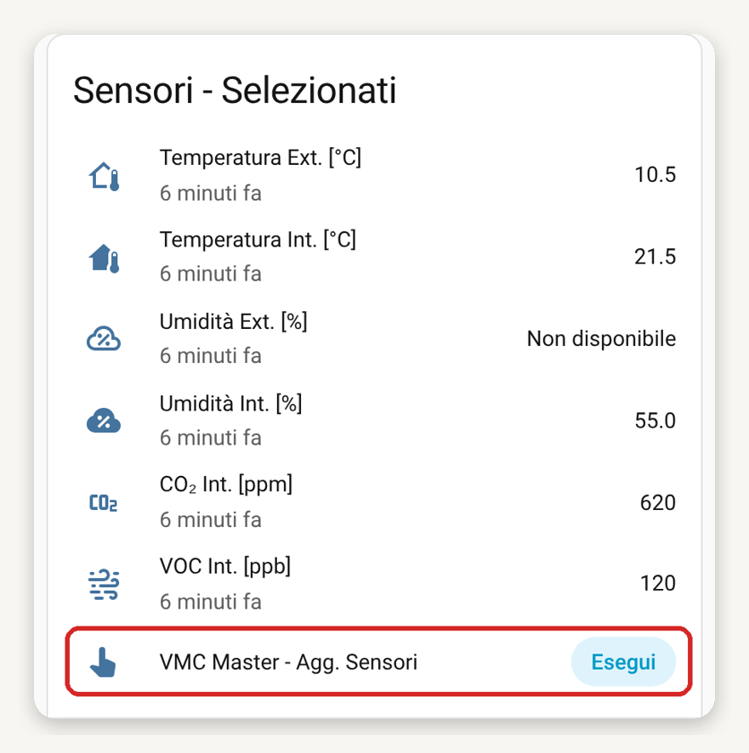
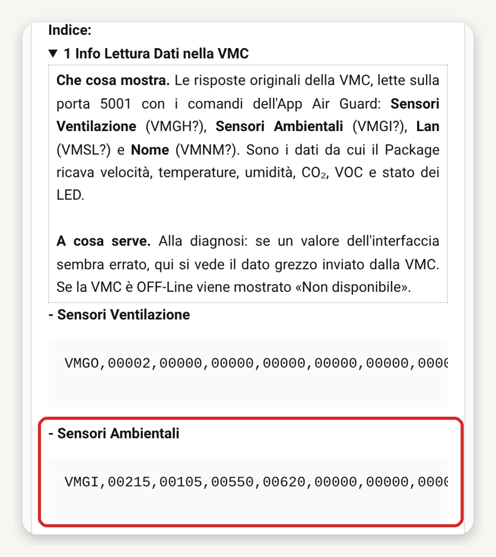

# Security Policy

### - Versione del SoftWare: [Link Release](https://github.com/DanRobo76/VMC-HELTY-FLOW/releases)

|          VMC-HELTY-FLOW Release          | Supportato da Home Assistant (Core)     |
| ---------------------------------------- | ----------------------------------------|
|  :white_check_mark: v.8.5.0              | :white_check_mark:   Ver. 2026.10.2     |
#
### - Limiti del SoftWare:<br>
<strong>La Lettura dei Sensori avviene ogni:</strong>
<pre style="font-size:10px; background-color: #d9ffcc;">
  -  05 Secondi, per la Lettura della Velocità della VMC (comando VMGH? sulla porta 5001);
  -  10 Secondi, per la Verifica On-Line della VMC (ping ICMP, non usa la porta 5001);
  -  1227 Secondi [20 MINUTI + 27 secondi di margine], per la Lettura dei Parametri Ambientali della VMC (comando VMGI?);
  -  43227 Secondi [12 ORE + 27 secondi di margine], per la Lettura del Nome della VMC (comando VMNM?);
  -  57641 Secondi [16 ORE + 41 secondi di margine], per la Lettura dei Dati LAN della VMC (comando VMSL?);
  -  86400 Secondi (24 ore), per la verifica della Versione del Software (GitHub, ultima Release pubblicata);
</pre>

Per Aggiornare tutti i sensori in real-time, senza attendere le tempistiche sopra esposte, aprire il pannello <strong>Sensori - Selezionati</strong> e cliccare su <strong>Esegui</strong> nella riga <strong>VMC Master - Agg. Sensori</strong>, confermando con <strong>OK</strong> nel popup «Vuoi Procedere?»:



Se si vogliono modificare le tempistiche, modificare i <strong>Secondi</strong> all'interno dei sensori contenuti nel File <strong>vmc_[NOME].yaml</strong>:<br>
<pre style="font-size:10px; background-color: #d9ffcc;">
  - vmc_[NOME]_status_ip
  - vmc_[NOME]_status_ventola
  - vmc_[NOME]_sensori
  - vmc_[NOME]_nome
  - vmc_[NOME]_lan
  - vmc_[NOME]_versione_repository
</pre>

Esempio (File <strong>vmc_master.yaml</strong>):

```yaml
command_line:
  - sensor:
      name: vmc_master_status_ip
      scan_interval:
        seconds: 10                            # Verifica On-Line

sensor:
  - platform: tcp
    name: vmc_master_status_ventola
    payload: "VMGH?"
    scan_interval:
      seconds: 5                               # Lettura della Velocità

  - platform: tcp
    name: vmc_master_sensori
    payload: "VMGI?"
    scan_interval:
      seconds: 1227                            # [20 MINUTI + 27 secondi di margine]

  - platform: tcp
    name: vmc_master_nome
    payload: "VMNM?"
    scan_interval:
      seconds: 43227                           # [12 ORE + 27 secondi di margine]

  - platform: tcp
    name: vmc_master_lan
    payload: "VMSL?"
    scan_interval:
      seconds: 57641                           # [16 ORE + 41 secondi di margine]

  - platform: rest
    name: vmc_master_versione_repository
    scan_interval: 86400                       # 24 ore
```

e riavviare Home Assistant.

#

### - PRIORITA' DI ATTIVAZIONE DEGLI ALLARMI
<pre style="font-size:10px; background-color: #d9ffcc;">
  - Congelamento ≤ -18 [°C] Temp. Ext. 0 Secondi per l'Attivazione
  - VMC Sensori Int. Δ Temp. > 23 [°C] 4 Secondi per l'Attivazione
  - INQUINANTI 8 Secondi per l'Attivazione
  - Sup. Lim. Δ PdR INQUINANTI 12 Secondi per l'Attivazione
  - Sup. Lim. Δ PdR 16 Secondi per l'Attivazione
  - FREE COOL./HEAT. INQUINANTI 20 Secondi per l'Attivazione
  - FREE COOL./HEAT. 24 Secondi per l'Attivazione
  - UMIDITA' 28 Secondi per l'Attivazione
  - BLACK-OUT 32 Secondi per l'Attivazione
  - CALENDARIO 3 Secondi per l'Attivazione (fasce orarie)
</pre>

Il comportamento della VMC per ogni allarme è riassunto nella tabella <strong>Logiche di Funzionamento</strong> del [README](README.md) e nella voce 18 del Pannello Informazioni.

#

### - ENTITA' ESCLUSE NEL DB DI HOME ASSISTANT
Nel File <strong>vmc_[NOME].yaml</strong> sono escluse dal Recorder 318 entità aggiornate di frequente (altre 31 sono già registrate, perché precedute dal simbolo #). Aggiungere o Togliere le Entità da escludere nel campo:

<pre style="font-size:10px; background-color: #d9ffcc;">
#################################################################################################################################
# Esclusione entità da Recorder, History e Logbook per ridurre il carico sul database escludendo entità aggiornate di frequente #
#                                                                                                                               #
#      METTERE DAVANTI AL SENSORE IL SIMBOLO #                                                                                  #
#                                                                                                                               #
#      ES. #      - sensor.vmc_master_status_ventola_lettura_codice_interpretato_interfaccia                                    #
#                                                                                                                               #
#      SIGNIFICA CHE VERRA' REGISTRATO NEL DB DI HOME ASSISTANT                                                                 #
#                                                                                                                               #
#################################################################################################################################
recorder:
  exclude:
    entities:
      - automation.vmc_master_aggiorna_aria_scambiata_e_gestisci_countdown
      - automation.automazione_vmc_master
      - automation.vmc_master_riepilogo_audio_avvio
      - automation.vmc_master_audio_allerte_e_stato
      - sensor.vmc_master_temperatura_esterna_selezionata
      - sensor.vmc_master_temperatura_interna_selezionata
      - sensor.vmc_master_umidita_esterna_selezionata
      - sensor.vmc_master_umidita_interna_selezionata
      - sensor.vmc_master_co2_interna_selezionata
      - sensor.vmc_master_status_ip
      - sensor.vmc_master_status_ventola
      - sensor.vmc_master_sensori
      - sensor.vmc_master_nome
      - sensor.vmc_master_lan
      - sensor.vmc_master_versione_repository
      - sensor.vmc_master_versione_corrente
      - sensor.vmc_master_verifica_ip_inserito
      - sensor.vmc_master_ip
      - sensor.vmc_master_status_ip_interfaccia
      - sensor.vmc_master_nome_status
      - sensor.vmc_master_status_ventola_lettura_codice
      - sensor.vmc_master_status_ventola_lettura_codice_interpretato
#      - sensor.vmc_master_status_ventola_lettura_codice_interpretato_interfaccia
      - sensor.vmc_master_status_sensori_lettura_codice_interpretato
      - sensor.vmc_master_status_led_pannello_lettura_codice_interpretato
      - ...
</pre>
#

### - In fase di Verifica la Lettura della Temperatura Interna o Esterna minore di 0 °C (Sensori della VMC):<br>

Aprire il <strong>Pannello Informazioni</strong>, espandere la voce <strong>1 Info Lettura Dati nella VMC</strong> e copiare la stringa <strong>Sensori Ambientali</strong> (evidenziata in rosso; la riga scorre in orizzontale):

<br>

Condividi la stringa per E-mail a: <a href="mailto:danilo.robotti@gmail.com">danilo.robotti@gmail.com</a>
<br><br>
Esempio Stringa dei Sensori Ambientali da Condividere:
<br>
<pre style="font-size:10px; background-color: #d9ffcc;">
VMGI,00209,00196,00708,00000,16384,02307,00224,00069,04354,00168,00000,00000,00000,00000,00000
</pre>
insieme allo ScreenShot dell'App Air Guard: <br>

<br>

, se rilevi una Temperatura Interna o Esterna minore di 0 °C (Negativa).
#
### - Rapporto Errori
[Link Release](https://github.com/DanRobo76/VMC-HELTY-FLOW/releases)
<br>
#
### - Curiosità: Impiego della VMC da remoto con l'uso di un Relè Smart, senza l'impiego di Home Assistant:<br>
<strong>1</strong> Nella VMC Flow Plus, una volta installato il relè e impostata una velocità diversa da zero, attendere 30 secondi prima di interrompere l'alimentazione;<br>
<strong>2</strong> Successivamente ripristinare l'alimentazione e portare la VMC alla Velocità 0;<br>
<strong>3</strong> Questa procedura consente attraverso l'utilizzo di un relè smart di spegnere o accendere la VMC con la velocità impostata precedentemente <strong>Punto 1</strong>, da remoto.<br>
