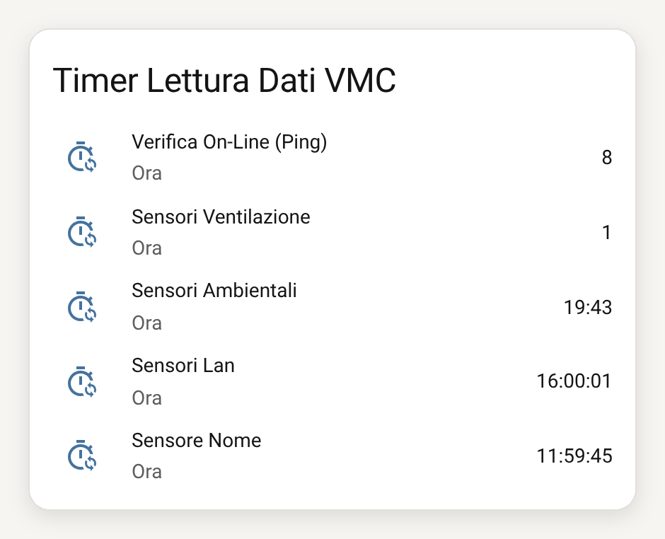
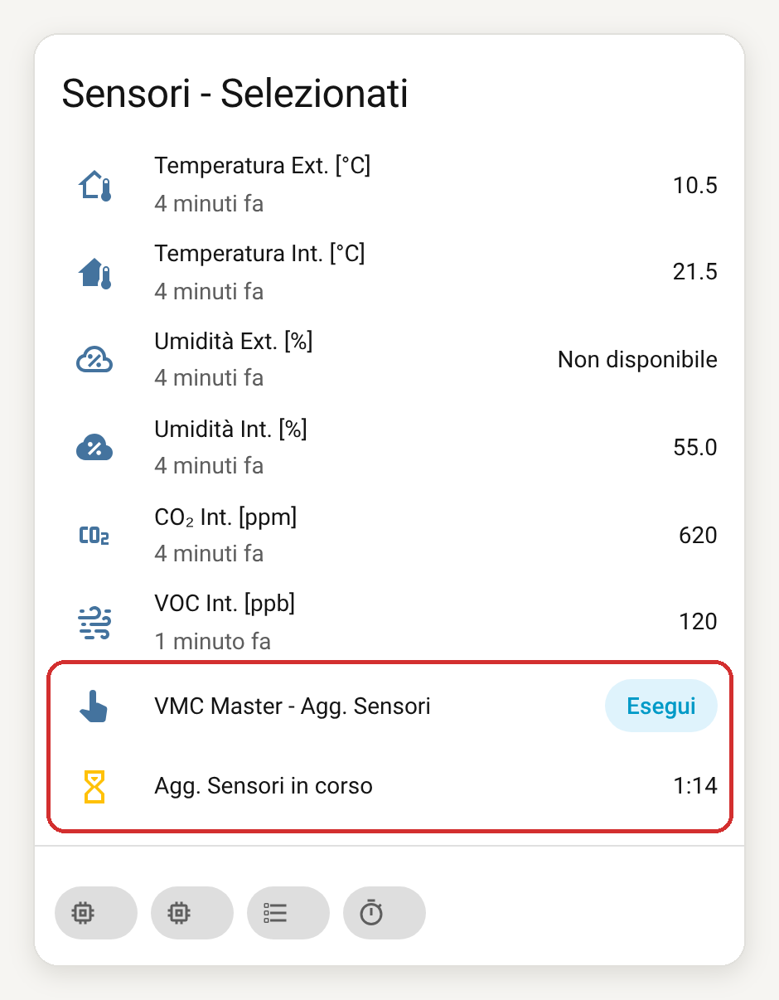
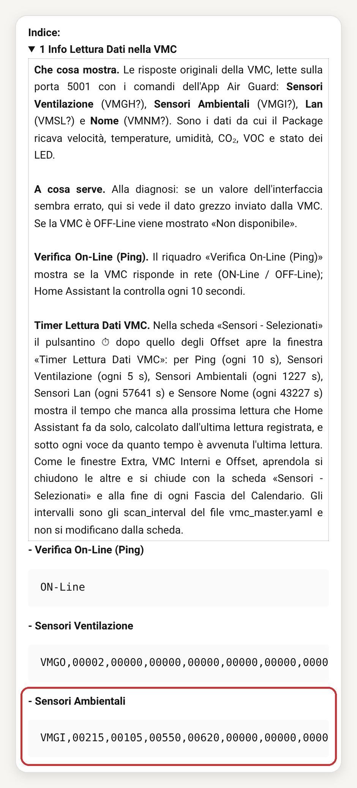

# Security Policy

Questa pagina riassume le versioni supportate, i limiti di funzionamento del Package **VMC-HELTY-FLOW** (tempi di lettura, priorità degli allarmi, gestione del database) e il modo corretto di segnalare un problema.

**Indice**

1. [Versioni supportate](#1-versioni-supportate)
2. [Lettura dei dati della VMC](#2-lettura-dei-dati-della-vmc)
3. [Aggiornamento immediato dei sensori](#3-aggiornamento-immediato-dei-sensori)
4. [Tempistiche: perché non vanno modificate](#4-tempistiche-perché-non-vanno-modificate)
5. [Priorità di attivazione degli allarmi](#5-priorità-di-attivazione-degli-allarmi)
6. [Entità escluse dal database di Home Assistant](#6-entità-escluse-dal-database-di-home-assistant)
7. [Temperature inferiori a 0 °C: verifica in corso](#7-temperature-inferiori-a-0-c-verifica-in-corso)
8. [Segnalazione di errori](#8-segnalazione-di-errori)
9. [Nota: uso della VMC con un relè smart, senza Home Assistant](#9-nota-uso-della-vmc-con-un-relè-smart-senza-home-assistant)

---

## 1. Versioni supportate

Le versioni pubblicate sono elencate nella pagina [Releases](https://github.com/DanRobo76/VMC-HELTY-FLOW/releases).

| VMC-HELTY-FLOW Release | Supportata da Home Assistant (Core) |
| :--------------------: | :---------------------------------: |
| :white_check_mark: v.8.5.1 | :white_check_mark: Ver. 2026.11.1 |

Sono supportate solo l'ultima release pubblicata e la versione di Home Assistant indicata. Prima di segnalare un problema aggiornare il Package all'ultima release.

---

## 2. Lettura dei dati della VMC

Home Assistant legge la VMC in automatico, con gli intervalli riportati sotto. Le letture TCP usano la porta **5001** della VMC; la verifica On-Line usa invece il ping (protocollo ICMP) e non occupa la porta 5001, quindi non entra in conflitto con le letture dei sensori.

| Lettura | Comando / Protocollo | Intervallo | Sensore (`vmc_master.yaml`) |
| --- | --- | ---: | --- |
| Velocità della VMC (Sensori Ventilazione) | `VMGH?`, TCP porta 5001 | **5 s** | `vmc_master_status_ventola` |
| Verifica On-Line della VMC | ping ICMP (3 tentativi a 1 s, durata massima 4 s) | **10 s** | `vmc_master_status_ip` |
| Parametri ambientali (Sensori Ambientali) | `VMGI?`, TCP porta 5001 | **1227 s** (20 minuti + 27 s di margine) | `vmc_master_sensori` |
| Nome della VMC | `VMNM?`, TCP porta 5001 | **43227 s** (12 ore + 27 s di margine) | `vmc_master_nome` |
| Dati LAN della VMC | `VMSL?`, TCP porta 5001 | **57641 s** (16 ore + 41 s di margine) | `vmc_master_lan` |
| Versione del software (ultima release su GitHub) | API GitHub (REST) | **86400 s** (24 ore) | `vmc_master_versione_repository` |

I secondi di margine sfalsano le letture lunghe, così che non coincidano con quelle più frequenti sulla stessa porta.

**Timer Lettura Dati VMC.** Nella scheda **Sensori - Selezionati** il pulsante ⏱ (dopo quello degli Offset) apre la finestra **Timer Lettura Dati VMC**: per Ping, Sensori Ventilazione, Sensori Ambientali, Sensori Lan e Sensore Nome mostra il tempo che manca alla prossima lettura automatica e da quanto tempo è avvenuta l'ultima.



---

## 3. Aggiornamento immediato dei sensori

Per rileggere subito tutti i dati della VMC (stato, sensori, nome e dati LAN), senza attendere gli intervalli sopra indicati:

1. aprire la scheda **Sensori - Selezionati**;
2. premere **Esegui** nella riga **VMC Master - Agg. Sensori**;
3. confermare con **OK** nel popup «Vuoi Procedere?».

Lo script dura **79 secondi**: sotto il pulsante compare la riga **Agg. Sensori in corso** con il tempo che manca alla fine. Attendere che la riga scompaia.



---

## 4. Tempistiche: perché non vanno modificate

> [!WARNING]
> **Si sconsiglia di modificare qualsiasi tempistica del Package**: gli intervalli di lettura della sezione 2, i secondi di attesa degli allarmi della sezione 5 e le pause degli script.
>
> Le tempistiche attuali sono state scelte per evitare **collisioni**, cioè comandi che Home Assistant invia alla VMC prima di aver riletto l'esito del comando precedente, e sono state verificate con simulazioni su Home Assistant reale e una VMC simulata (lenta e veloce):
>
> | Prova | Scenari | Collisioni |
> | --- | ---: | ---: |
> | Allerte singole e coppie di allerte | 17.264 | **0** |
> | 3 allerte | 44.640 | **0** |
> | 4 allerte contemporanee | 23.040 | **0** |
> | 5 allerte contemporanee *(in corso)* | 44.951 su 144.000 | **0** |
>
> Con valori diversi questa verifica non è più valida e possono comparire collisioni, comandi ripetuti o velocità errate.

Ulteriori motivi:

- i secondi di attesa degli allarmi sono **fissi**: il Profilo Inizializzazione li riporta comunque ai valori originali;
- gli intervalli di lettura sono ripetuti nell'automazione **VMC Master - Countdown Letture VMC**, che deve avere valori identici agli `scan_interval` dei sensori: modificandone solo uno, i timer della finestra Timer Lettura Dati VMC risultano sfasati;
- letture TCP più frequenti aumentano il traffico sulla porta 5001, usata anche dai comandi di velocità, e quindi la probabilità che una lettura e un comando si sovrappongano.

Gli intervalli sono definiti nel file **vmc_[NOME].yaml** (esempio `vmc_master.yaml`), solo come riferimento:

```yaml
command_line:
  - sensor:
      name: vmc_master_status_ip
      scan_interval:
        seconds: 10                            # Verifica On-Line (ping)

sensor:
  - platform: tcp
    name: vmc_master_status_ventola
    payload: "VMGH?"
    scan_interval:
      seconds: 5                               # Velocità della VMC

  - platform: tcp
    name: vmc_master_sensori
    payload: "VMGI?"
    scan_interval:
      seconds: 1227                            # [20 MINUTI + 27 secondi di margine]

  - platform: tcp
    name: vmc_master_nome
    payload: "VMNM?"
    scan_interval:
      seconds: 43227                           # [12 ORE + 27 secondi di margine]

  - platform: tcp
    name: vmc_master_lan
    payload: "VMSL?"
    scan_interval:
      seconds: 57641                           # [16 ORE + 41 secondi di margine]

  - platform: rest
    name: vmc_master_versione_repository
    scan_interval: 86400                       # 24 ore
```

---

## 5. Priorità di attivazione degli allarmi

Gli allarmi sono elencati in ordine di priorità, dalla più alta alla più bassa, con i secondi che devono trascorrere prima dell'attivazione (gli stessi valgono per la ripresa). I secondi sono fissi e non vanno modificati.

| Priorità | Allarme | Secondi per l'attivazione |
| :---: | --- | ---: |
| 1 | Congelamento ≤ -18 °C Temp. Ext. | 0 |
| 2 | VMC Sensori Int. Δ Temp. > 23 °C | 4 |
| 3 | Inquinanti (CO₂ e VOC) | 8 |
| 4 | Sup. Lim. Δ PdR con Inquinanti | 12 |
| 5 | Sup. Lim. Δ PdR | 16 |
| 6 | Free Cooling / Free Heating con Inquinanti | 20 |
| 7 | Free Cooling / Free Heating | 24 |
| 8 | Umidità | 28 |
| 9 | Black-Out (rilevamento e ripristino) | 32 |
| – | Calendario (ingresso e uscita dalla fascia oraria) | 3 (+5 s dello script della fascia all'ingresso) |
| – | Avvisi (riquadro Avvisi e avviso di aggiornamento del Package) | 5 |

Il comportamento della VMC per ogni allarme è descritto nel foglio **Logiche di Funzionamento** del [README](README.md) e nella voce **17 Logiche di Funzionamento** del Pannello Informazioni.

---

## 6. Entità escluse dal database di Home Assistant

Per ridurre il carico sul database, nel file **vmc_[NOME].yaml** le entità aggiornate di frequente sono escluse da Recorder, History e Logbook. Nel file `vmc_master.yaml` l'elenco contiene **453** entità escluse e **50** entità registrate (righe precedute dal simbolo `#`). Nelle VMC create con lo script Clona le entità escluse sono **426**, perché le 27 entità di Installa VMC esistono solo nella VMC Master.

Lo stesso elenco è usato anche dal pannello **Pulisci cronologia Entità** della scheda.

- **Riga attiva** `      - sensor.vmc_master_xxx`: l'entità è esclusa e non viene registrata nel database.
- **Riga commentata** `#      - sensor.vmc_master_xxx`: l'entità viene registrata nel database.

Regole (dall'intestazione della sezione `recorder` del file):

- non modificare la riga `entities: &vmc_master_entita_escluse_recorder`;
- non commentare la prima riga `input_select.vmc_master_entita_escluse_recorder`, che deve restare sempre esclusa;
- dopo ogni modifica riavviare Home Assistant;
- la cronologia già registrata non si cancella da sola: per eliminarla usare **Pulisci cronologia Entità** nella scheda.

```yaml
recorder:
  exclude:
    entities: &vmc_master_entita_escluse_recorder
      - input_select.vmc_master_entita_escluse_recorder
      - automation.vmc_master_aggiorna_aria_scambiata_e_gestisci_countdown
      - automation.automazione_vmc_master
      ...
#      - sensor.vmc_master_status_ventola_lettura_codice_interpretato_interfaccia
      ...
```

---

## 7. Temperature inferiori a 0 °C: verifica in corso

La lettura delle temperature interna ed esterna inferiori a 0 °C, ricavata dai sensori della VMC, è ancora in fase di verifica: il segno negativo è interpretato secondo il formato atteso, ma non è ancora stato confermato con una VMC reale.

Se la VMC rileva una temperatura interna o esterna negativa, si chiede di inviare i dati seguenti:

1. aprire il **Pannello Informazioni**, espandere la voce **1 Info Lettura Dati nella VMC** e copiare la stringa **Sensori Ambientali** (evidenziata in rosso; la riga scorre in orizzontale);

   

   Esempio di stringa:

   ```
   VMGI,00209,00196,00708,00000,16384,02307,00224,00069,04354,00168,00000,00000,00000,00000,00000
   ```

2. allegare lo screenshot dell'App **Air Guard** con le temperature nello stesso momento;

   

3. inviare stringa e screenshot per e-mail a <a href="mailto:danilo.robotti@gmail.com">danilo.robotti@gmail.com</a>.

---

## 8. Segnalazione di errori

Per segnalare un errore scrivere a <a href="mailto:danilo.robotti@gmail.com">danilo.robotti@gmail.com</a> indicando:

- la release installata (riquadro della versione nella scheda) e la versione di Home Assistant;
- una descrizione del problema e, se possibile, i passi per riprodurlo;
- le stringhe della voce **1 Info Lettura Dati nella VMC** e gli eventuali messaggi di errore dei log.

Le correzioni sono pubblicate nella pagina [Releases](https://github.com/DanRobo76/VMC-HELTY-FLOW/releases).

---

## 9. Nota: uso della VMC con un relè smart, senza Home Assistant

La VMC Flow Plus può essere accesa e spenta da remoto con un relè smart sull'alimentazione, anche senza Home Assistant:

1. installato il relè, impostare una velocità diversa da 0 e attendere **30 secondi** prima di togliere l'alimentazione;
2. ripristinare l'alimentazione e portare la VMC a Velocità 0;
3. da quel momento il relè smart accende o spegne la VMC da remoto con la velocità impostata al punto 1.
